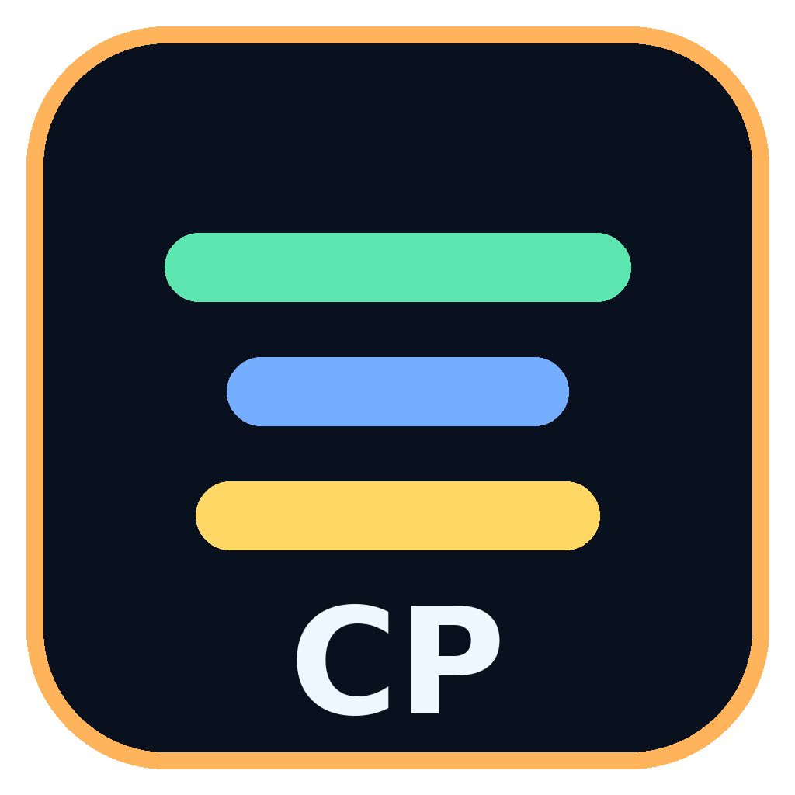
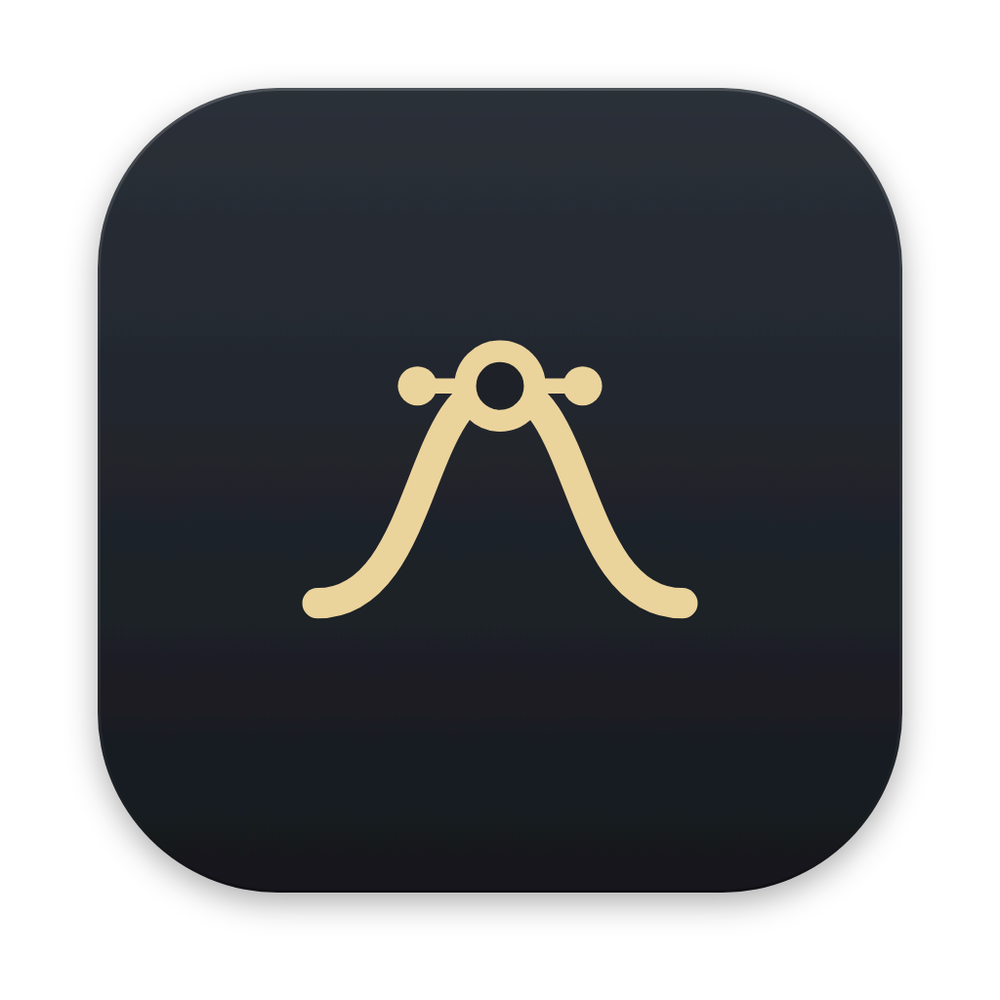
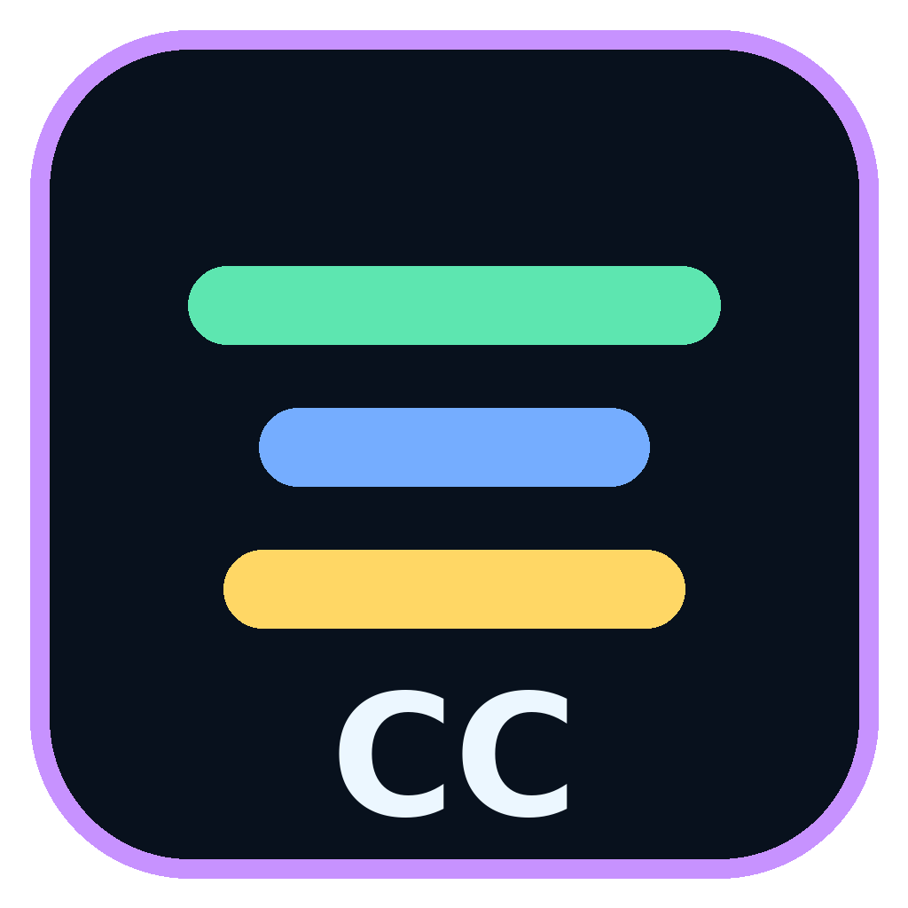
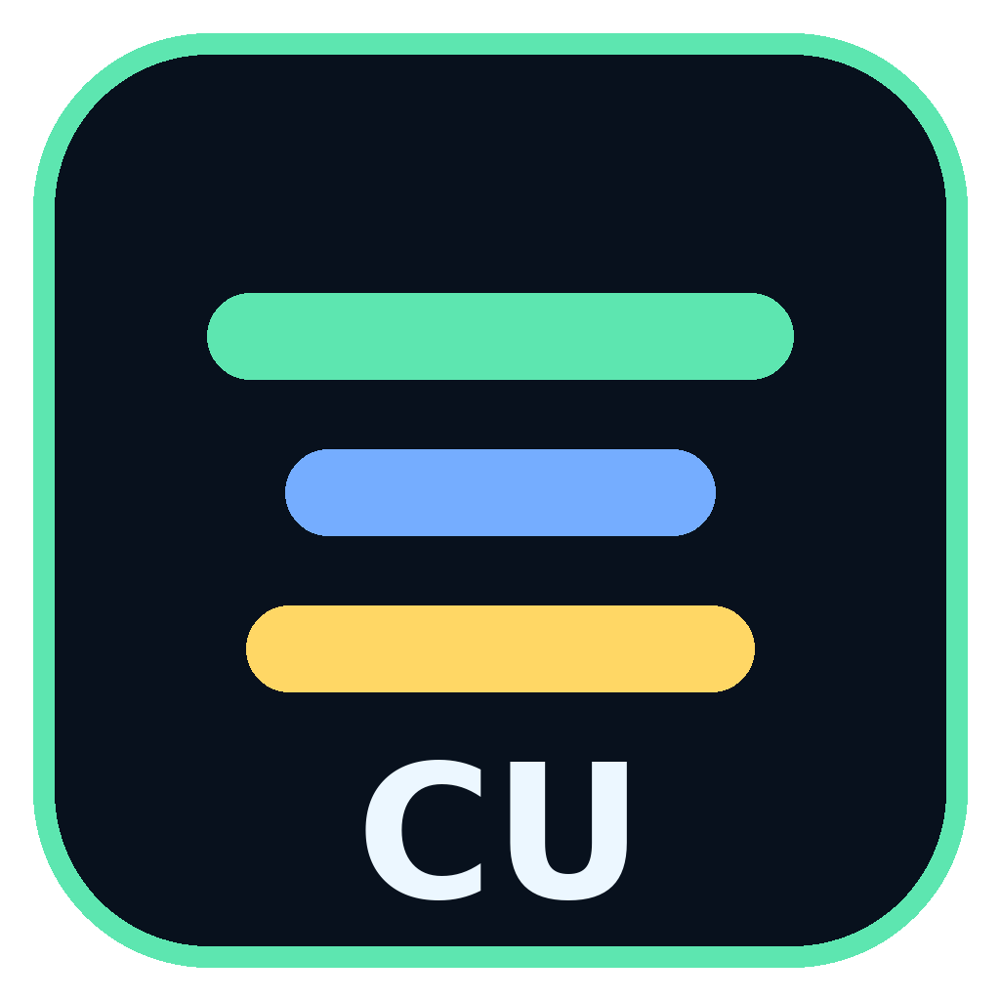
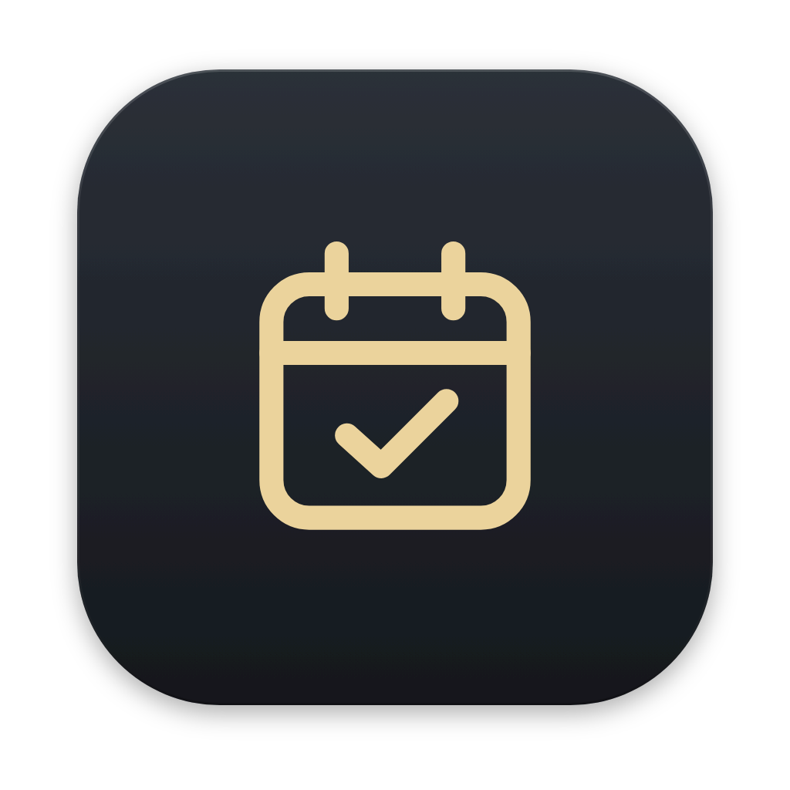
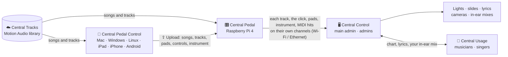

<div align="center">



# Central Pedal

**Tracks, pads, the instrument rig, lights, lyrics and in-ears for worship teams: one system on every device.**

[](https://github.com/MotionAudio/Central-Apps/releases/latest)
[](https://github.com/MotionAudio/Central-Apps/actions)
[](LICENSE)

[**Download**](https://motionaudio.github.io/Central-Apps/) · [Install guide](INSTALL.md) · [Release notes](release-notes/) · [Central Tracks API](docs/CENTRAL-TRACKS-API.md)

</div>

---

## The apps

| | App | Who it's for | What it does |
|:-:|---|---|---|
|  | **Central Pedal** | The stage | A Raspberry Pi 4 that boots straight into the pedal. It has ambient pads, a multitrack player (stems, click, spoken cues, chord charts, lyrics) and a guitar / keys rig, played from a touch screen, 12 footswitches, knobs, an expression pedal, MIDI and a Stream Deck. |
|  | **Central Pedal Control** | Whoever gets the songs ready | The same Central Pedal app on your computer, tablet or phone. You build the setlist, add songs and tracks, and set up pads, controls and the instrument anywhere. Then **⇪ Upload** it all to the pedal. |
|  | **Central Control** | The main admin and admins | Lights, slides, lyrics, cameras, in-ear mixes, the tracks and the mix, for the whole team. |
|  | **Central Usage** | Musicians and singers | Your chord chart, your instrument, the lyrics and your own in-ear mix. |
|  | **Central Services** | Everyone in the church | The schedule: services, who's asked to serve, and everyone's yes or no. Admins see the whole schedule; users see their own requests. |

## Platforms

| | Central Pedal | Central Pedal Control | Central Control | Central Usage | Central Services |
|---|:-:|:-:|:-:|:-:|:-:|
| **Raspberry Pi 4** | ✅ | | | | |
| **macOS** (Apple Silicon, Intel) | | ✅ | ✅ | ✅ | ✅ |
| **Windows** 10 / 11 | | ✅ | ✅ | ✅ | ✅ |
| **Linux** (.deb, AppImage) | | ✅ | ✅ | ✅ | ✅ |
| **iPadOS** | | ✅ ¹ | | ✅ ¹ | ✅ ¹ |
| **iOS** (iPhone) | | ✅ ¹ | | ✅ ¹ | ✅ ¹ |
| **Android** | | ✅ | | ✅ | ✅ |

¹ iPhone and iPad: through TestFlight and the App Store once the Apple developer account is set up ([IOS-APP-STORE.md](IOS-APP-STORE.md)).
Central Usage also runs in Safari today, served by the main admin's computer.

Every release is built and tested for every system by GitHub Actions. Every installed app looks for a new version
every time it opens and installs it by itself after a 10-second notice (Android: it downloads, then one tap on
**Update**). Songs, setlists, settings, keys and sign-ins are never touched by an update.

## How it fits together



## Highlights

**Songs and tracks**
- **Add a song** in four ways:
  1. your own stems
  2. the whole song split into stems
  3. a MultiTracks.com / Loop Community (Prime) download, with its Ableton sections
  4. **Central Tracks**

  Planning Center plans come in too.
- **Stem splitter, Studio mode.** One WAV of the whole song becomes the tracks a band plays with, on your own computer:
  Lead Vox, BGVs, Drums, Perc, Bass, Guitars, Keys, Synth & Pads, plus a Click and a Guide.
  - Several RoFormer vocal models vote on the vocals; Demucs FT and the 6-stem model split the band.
  - A clean-up pass takes the reverb off the vocals, removes the bleed between the tracks, trims the silence, writes
    mono tracks as mono and leaves out silent ones.
  - Check the tracks before adding them: play, solo, rename, merge, or split one again.
  - The drum hits (kick, snare, hi-hat, crash) still go to Central Control for the lights, as MIDI notes and on its
    timeline, with the tempo.
- **Sections are found for you.** Intro, verse, pre-chorus, chorus, bridge and outro come from the vocals, the harmony
  and the loudness. Tempo, key, the beat grid and big hits are found too. A click and a spoken guide come from the
  grid.
- **Practice mixes** for every musician:
  - their part up, alone or left out
  - slower without changing the pitch, or in another key
  - a count-in

  The band plays them on their phones.
- A full mixer, scenes, segues (gapless or crossfaded), live arrangement, key and tempo changes.

**Live**
- The **LIVE** screen:
  - the whole service on one screen
  - **Safe Stop**
  - the service lock
  - a **Ready check** before the service
  - a **service report** afterwards
- **Backup player:** a second pedal follows in step, silently, and takes over mid-song if the first one stops.

**Control**
- Footswitches, knobs, sliders, an expression pedal, USB foot pedals and MIDI.
- **Elgato Stream Deck**, with your own keys and pages.
- Ableton Link, MIDI clock and hits out, and ProPresenter.

**Instrument**
- Guitar and bass pedalboards (600+ free plugins on the Pi, a built-in rig on Windows and macOS).
- Keys from SoundFonts, with layers and splits.
- A tuner, an IR loader and a looper.

**The team**
- With Central Control, the main admin pairs every device, gives each pedal its job (track player, controller,
  instrument rig, backup) and runs:
  - lights (DMX, fixture library, timecode)
  - slides, lyrics and cameras (NDI)
  - 64 in-ear mixes
  - talkback
- With Central Usage, musicians get their own chart, lyrics and in-ear mix.

## Get started

1. **Install the apps.** The [download page](https://motionaudio.github.io/Central-Apps/) picks the right file for
   your device. Step-by-step help and Linux commands are in [INSTALL.md](INSTALL.md).
2. **Set up the Central Pedal.** Build the SD card image on an Ubuntu PC ([details below](#the-raspberry-pi-image)),
   flash it and boot. It goes straight to the Central Pedal screen.
3. **Get your songs ready** anywhere in Central Pedal Control, then press **⇪ Upload** with the pedal's name and PIN.
4. **Bring in the team.** The main admin installs Central Control, and the pedals and every musician's device pair
   with it.

### The Raspberry Pi image

1. **Build it** on your Ubuntu PC. The first build takes 40–60 minutes and needs internet and about 15 GB free:

   ```bash
   sudo WIFI_SSID="Church WiFi" WIFI_PASS="password" bash build-image.sh
   ```
   - You get `central-control-os-<version>.img`. Always build from the folder you unzipped the newest
     `central-control-source.zip` into. Delete older images so they can't be flashed by mistake.
   - Options:
     - `PI_PASS=...`, `PI_HOSTNAME=...`
     - `TFT=waveshare35a`: the 3.5" screen is on from the first boot.
     - `I2S_DAC=off`, `SAFE_MODE=off`, `WIFI_COUNTRY=US`, `COMPRESS=1`
     - `SOUNDS=small` skips the 1.2 GB grand piano; `SOUNDS=none` leaves out the keys sound banks.
   - Use a 16 GB card or bigger.
2. **Flash it** with Raspberry Pi Imager: *Choose OS → Use custom*, then pick the `.img`. Answer **No** to *OS
   customisation*.
3. **Boot.** The first boot takes about a minute longer and restarts once. After that, every boot goes straight to the
   Central Pedal. The start-up screen and the top-right of the app show the version.
4. **Wire the controls** with `wiring.html`. Every part is optional, and the Learn tab can move any button or knob to
   any pin. A guitar needs a USB audio interface; a keyboard needs a USB MIDI port.

**Other Wi-Fi later:** put `pad-pedal-wifi.txt` (the network name on line 1, the password on line 2) on the card's
`bootfs` partition, or use Settings → Wi-Fi on the screen. Maintenance login: `ssh pi@padpedal.local`.

## Central Tracks

The Motion Audio community library, built into **Add a song → Central Tracks** in Central Pedal and Central Pedal
Control:
- Search by song, artist or key.
- With **Central Tracks Unlimited**, add any track.
- Otherwise, buy the tracks you need. Prices come from each track's audio-quality grade.

Teams publish tracks on the Motion Audio website. Songs you import yourself never leave your devices. The server
API is in [docs/CENTRAL-TRACKS-API.md](docs/CENTRAL-TRACKS-API.md).

## Documentation

| | |
|---|---|
| [INSTALL.md](INSTALL.md) | Installing every app on every system, updating, Linux commands |
| [IOS-APP-STORE.md](IOS-APP-STORE.md) | iPhone and iPad builds: TestFlight and App Store |
| [DRIVE-SETUP.md](DRIVE-SETUP.md) | A copy of every release in Google Drive |
| [docs/CENTRAL-TRACKS-API.md](docs/CENTRAL-TRACKS-API.md) | The Central Tracks server API |
| [release-notes/](release-notes/) | What changed in each version |
| [central-usage/README.md](central-usage/README.md) | Central Control and Central Usage in depth |
| [The user guide below](#the-tabs) | Every tab of the Central Pedal, the hardware, screens, MIDI and safe mode |

## Release history

<details>
<summary><b>What's new in each version</b> (8.12 and earlier)</summary>

**New in version 8.12:**
- **Forgot password** on the website, in every app's sign-in and in Central Services (an emailed link, once, for an hour).
- **Invite reminders** after 3 and 7 days; **Move to…** another team (new key and app by email, old key freed).
- **Central Services** emails everyone serving the day before, and nudges anyone who hasn't answered.

**New in version 8.11:**
- **Teams:** the main admin adds Admins, Users and Pedal Control people (name, email, role); each gets an email with
  the link to make their account, their app's download link and their key. The church page shows the keys left.
- **Keys:** an admin key on one device; a user key or Pedal Control key on two (church and home), same account only.
  Settings follow the account, so both devices match.
- **Updates on open** for every app, Android included. The Wi-Fi step is skipped when already online.
- **Central Services** (new): the church's schedule; it knows whether the account is an admin or a user.

**New in version 8.10:**
- **License keys and church accounts:** the first-open setup (internet, production, key, account). Keys work one device
  at a time: P keys for Central Pedal and Pedal Control, A keys for admins, U keys for users. Release key in Settings
  or on the website. Church packs and new prices on the website. The apps ask for keys once the website is live.

**New in version 8.9:**
- **Stem splitter, Studio mode:** vocal models voting together, Demucs FT and the 6-stem model for the band, then lead
  and backing vocals, the reverb off the vocals and the drum kit piece by piece.
- **Clean-up pass:** bleed removal (the tracks add up to the song again), Perc, the kit as Drums or Cymbals, the
  silence trimmed, mono tracks written mono, silent tracks left out.
- **MultiTracks-style tracks:** Lead Vox, BGVs, Drums, Perc, Bass, Guitars, Keys, Synth & Pads, with a Click track and
  a Guide track made from the beat grid and the sections.
- **Check before adding:** play, solo and mute, rename, set the role, merge, or split one track again.
- **Drum hits for the lights:** kick, snare, hi-hat and crash from a split song go to Central Control as MIDI notes
  and on its lighting timeline, with the tempo. Each has its own note and preset.

**New in version 8.8:**
- **Central Pedal Control on every system:** macOS, Windows, Linux, iPadOS, iOS and Android.
  **Central Usage on Linux** (.deb, AppImage).
- **Add a song:** your songs first, or a new one, then four ways to bring its tracks in:
  1. your own stems
  2. the whole song split
  3. MultiTracks.com / Prime
  4. Central Tracks
- **Stem splitter, best quality:** the RoFormer vocal model with Demucs for the band. It can also split lead from
  backing vocals, and the drums into kick, snare, toms, hi-hat, ride and crash. Each step shows its progress and the
  time left.
- **Sections found from the tracks:** intro, verse, pre-chorus, chorus, bridge, instrumental, tag and outro, from the
  vocals, the harmony and the loudness. After a split, the click and the spoken guide are switched on.

**New in version 8.6:**
- **Backup player:** a second Central Pedal (or the main admin's player window) plays along silently, in step, and
  fades in where the song is if the track player stops mid-song - automatic or with a TAKE OVER button.
- **Elgato Stream Deck** (Original, MK.2, XL, Mini, Neo, +): any action on any key, your own labels, icons and
  colours, pages, keys that light with what they control.
- **Practice mixes** (Tracks → 🎧): a file of each song for each musician - their part up, alone or out, click and
  guide on or off, slower without changing the pitch, another key, a count-in - kept on the Central Pedal for the
  band's phones (`http://<pedal>.local:8080/practice/`), a USB stick, a download or a folder on the Mac.
- **Stem splitter** (Tracks → ✂): a stereo song becomes drums, bass, vocals and the rest (or 6 stems) with Demucs,
  on your own computer, installed only when you ask; every Demucs setting is there.
- **Each track, the click, the pads and the instrument go to the main admin on their own channels** as soon as a
  Central Pedal is the track player or the instrument rig (Ethernet or Wi-Fi), with the MIDI hits; set it up in
  Central Pedal Control and Upload it.

**New in version 8.5:**
- **Four apps.** **Central Pedal Control** (new, Mac and iPad): the Central Pedal app away from the pedal - build the
  setlist, import tracks, set up pads, controls and the instrument at home, then **⇪ Upload** them to the pedal with
  its PIN (the pedal asks before it applies them, never while it plays); **⇩ Download** brings the pedal's setup back.
  **Central Usage** (new, Mac, Windows, Android; iPhone / iPad): the musicians' app - User 1 / User 2 only.
  **Central Control** (Windows, Mac, Linux) is now the main admin's and admins' app.
- **Android:** Central Usage as an `.apk` on the download page; it finds the main admin's computer on the Wi-Fi.
- The main admin's Devices tab shows which devices run Central Usage; they can't be made admins.

**New in version 8.4:**
- **LIVE screen** (the first tab): the whole service on one screen - the setlist, the song (key, BPM, time left, what
  comes next), its sections to jump to, big Play / Pause, Vamp, **Safe Stop** (fades out instead of cutting), next
  song, the pads, the instrument with its tuner, meters, and the Pi's temperature (°F).
- **Service lock:** while the service runs only playing works - the other tabs, the mixer and tracks mode are locked
  until the Central Pedal's PIN unlocks it (it stays locked through a restart).
- **Service report:** LIVE → 📋 Report - what played on a day and when, how long, how each song ended, its
  sections, safe stops, audio dropouts and the hottest temperature (°F); download it as text.
- **Ready check** before the service: the sound, the outputs (the click only to the in-ears), every song's tracks and
  sections, the Pi's temperature, power, storage and memory, the pairing - green "Ready" or a list of what to fix.
- **MultiTracks.com / Loop Community (Prime) downloads:** the WAV stems become a song with its **sections read from the
  Ableton set or MIDI file** in the download, an option to **combine** stems of the same kind (fewer tracks to mix,
  less memory), a memory check, and **several songs at once** (a folder of downloads or zips).

**New in version 8.3:**
- **The main admin is the center:** pairing, roles, the Devices tab, locks, services and the in-ear host live in the
  main admin's Central Control - so everything works **without a Raspberry Pi**.
- **Tracks, charts and lyrics** come from the main admin's **player window** (the Central Pedal app, built into Central Control on that
  computer) - or from a **Central Pedal**: add as many as you like with the pairing PIN, and on the Devices tab
  pick each one's job: **Track player**, **Foot controller** (drives the track player) or **Instrument rig**.
  Every device follows the track player; songs are copied to every pedal.
- **Talkback groups:** the main admin talks to the **Band** or to **Production** (each device's group is set on the
  Devices tab); everyone else's talkback goes only to the main admin's headphones.
- **Central Pedal is Raspberry Pi only**; Central Control runs on Windows, Mac (Apple Silicon / Intel) and Linux,
  with the user side on iPhone and iPad.
- **Raspberry Pi:** Wi-Fi fixed (hidden networks, WPA3, the country, clear errors); **touch screens by size** (2.2" -
  10.1": GPIO, HDMI and ribbon-cable screens, the maker's driver downloaded when needed); HDMI 1 shows a copy of the
  touch screen (or lyrics / chord charts / the app), HDMI 2 lyrics or chord charts; the touch panel no longer
  moves the mouse.

**New in version 8.2:**
- **New names:** the Pi (and its PC version) is **Central Pedal**; the companion app (Central Usage until now) is
  **Central Control**. Settings, songs and updates carry on - the installer files keep their old names.
- **Pairing:** the main admin is set up first (its inputs and outputs, a 4-digit **pairing PIN**, and its own
  **role PIN**). Every other device - Admin, User 1, User 2, and the Central Pedal on its own screen - pairs with
  that one pairing PIN. An admin without the role PIN waits for the main admin to allow it.
- **Devices tab** (main admin): every device, its role and jobs, and how its connection is doing (round trip,
  in-ear buffer and dropouts, CPU, battery, version), with Change role, Jobs, Lock / Unlock, Rename, Remove.
  The main admin picks its own job too (everything = production manager, or e.g. lighting).
- **Locks:** the main admin's **service lock** (everyone, or one device) closes the I/O tab, settings and set-up
  pages during the service; anyone can **manual-lock** their own computer (hold 🔒 for 2 seconds to unlock).
- **Services:** up to 4 (day, time, run order with minutes, the roles each item uses). Every computer counts down
  to **its own next part**; the stage display shows the service countdown.
- **Talkback:** admins talk into everyone's in-ears or chosen ones (hold, or tap to latch; music dims);
  musicians can talk to the sound desk.
- **Recording:** every input, the tracks and a stereo program mix (plus an MP3 for the podcast) on the audio
  host - by hand, or automatically with a service.
- **Faster boot** on the Raspberry Pi.

**New in version 8.1:**
- **More sounds:** 40 more pads (121), 30 more pedals (239) and 17 more keys
  banks: an old piano, a bright upright, synth brass, synth and electric basses,
  harp, clarinet, tenor sax, recorder, glass, hang, xylophone, kalimba. Every
  pedal's knobs were checked against its plugin: 85 pedals had knobs pointing at
  controls the plugin doesn't have (they showed up only under *more*) and the
  board presets that used them (Clean Worship, Edge Dotted-Eighth, Modern High
  Gain) didn't set their delay; all fixed.
- **The same songs and setlists on every Central Pedal.** Link the Pi and
  Central Pedal on your computers once (Setlist → *Setlists · Song library ·
  Devices* → *Link…* with the other one's code). After that, a setlist made on the
  PC shows up on the Pi to open, and every song with its stems, chart and light
  show copies both ways by itself; the newest edit wins. The Pi keeps the tracks of
  songs that are in a setlist (cards are small); computers keep everything.
  Deleting asks: *from this setlist*, *on this device*, or *everywhere*.
- **Parts for every instrument** (song editor → *Parts for every instrument*):
  guitar (chart with capo and chord diagrams, or tab), bass, keys (both hands),
  vocals (melody with words), trumpet / clarinet / alto and tenor sax / horn in F /
  trombone in their keys, violin, cello and a drum chart, plus the chord chart and
  Nashville numbers. *Listen to every track* writes down what each track plays
  (drums too: kick, snare, hats, crash), so the parts are the real ones; songs
  without tracks get parts written from the chords. The bass track also makes the
  heard chord chart more accurate.
- **Lyrics + chords from the vocal** (Central Pedal on a PC, and Central Control):
  an offline speech model hears the words in the vocal track and writes the lyric
  chart with the chords on the right words.
- **Central Control roles**: one main admin with a PIN and a pairing code, admins
  with jobs (lighting, production, mix, in-ears, slides), User 1 and User 2.
- **Touch select**: give any knob, slider or the encoder the *Touch select* job
  (Configure). Tap any setting on the screen - a pedal's knob, a fader, the pad
  sound - and that knob changes it. It picks up from where the setting is (an
  arrow says which way to turn), stays until you tap something else, and the
  3.5-inch screen shows what it holds.
- **Saved setups**: save the buttons / knobs jobs, volume / tone / reverb /
  fade, the instrument (boards, pedals, keys), textures, colours and projector
  look under a name ("Sunday", "Youth night") and bring them back with one tap;
  each song can have its own setup. Setups stay on that device - songs, tracks
  and setlists are what sync.
- **Pairing PIN**: the first time a Central Pedal starts, you pick its 4-digit
  pairing PIN (Settings → Wi-Fi & devices changes it). It is separate from the
  main admin's PIN in Central Control.
- **Tuner** on the Instrument tab: one button (or a footswitch, which opens the
  tab), mute or keep playing while tuning, and it shows on the 3.5-inch screen.
- **iPhone and iPad**: Central Control opens from the Central Pedal at
  `http://padpedal.local:8080/cu/` (Add to Home Screen).

**New in version 8:**
- **The Central Pedal's audio goes to Central Control.** Every track goes on its
  own channel, plus the click, pads, the tracks mix and the instrument. It travels
  over **Ethernet** or **Wi-Fi**, or through the **audio interface**; you pick which
  on the new **I/O tab**, which lists every input and output.
- **Learn has one layout.** It covers 12 buttons, 6 knobs and 2 sliders, and every
  function can go on any of them: play all, stop all, the next song, sections,
  rehearsal and more.
- **Pads follow the tracks.** They follow the song's key and tempo, start and stop
  with the tracks, swell by section, and each song can have its own pad.
- **The Tracks tab has a mixer** right on the page. It also shows **one combined
  waveform** with every section in its standard colour.
- **Settings → Colours of everything:** the screen, the section colours and the pad
  colours.
- **Rehearsal tools:** A–B loop, loop a section, back or next section, and slow down.
- A big **guitar tuner**, and song notes and cues on the stage display.
- **More sounds:** 81 pads, 59 more pedals, a bass board, a piano bank, and an
  on / off **live looper** under the instrument.
- **Slides on HDMI 2:** pictures, videos and lyrics sent from Central Control.

**In Central Control 2.0:**
- **The Mix tab** gives every track its fader, pan, mute, high-pass, 3-band EQ and
  compressor. The tracks go out of the USB interface summed (L/R) or each on its
  own output.
- **The In-ears tab** handles up to 128 channels and 64 mixes (48 in 8.0). People on stage pick
  a free mix and set their own levels from Central Control or a phone. Their mix
  plays on that device over Wi-Fi (local), or leaves the audio host's interface for
  a pack (cloud).
- On the audio host you can **listen to any mix** and **record the service**.
- **Lighting** runs in Auto, Semi-auto or Manual mode. It shows the waveform with
  the hit lines, takes plain-word orders ("back blue 30% for the verse…"), and
  records what you press so you can record over any part later. You can change
  every light's colour in a list, edit presets, keep songs with any number of
  scenes (with or without tracks) that follow any tempo, use more than one
  universe, and run a click that you can hear, that the lights follow, and that
  can go to an audio output. The lights also react to the music.
- **Slides:** pictures, video and lyrics go to a second screen, the Central
  Pedal's HDMI 2 and NDI.
- **The Instrument tab** is the same guitar / bass / keys rig as on the Pi.

**New in version 7.1:** the HDMI picture is right on any monitor - its own
native resolution (sharp, not stretched), the whole app on screen, a monitor
that wakes up late or gets swapped mid-service is picked up by itself without
stopping the sound, and Settings → Screens can pick the resolution, the zoom
and pull the picture in on screens that cut the edges off · the Inter typeface
built in, so the app looks the same everywhere · the version shown on the
start-up screen and in the top bar · it starts on the tab you used last
(the very first time: Tracks) · proper text boxes everywhere (a pasted chord
chart keeps its lines; the Wi-Fi password is hidden; works in the PC app too) ·
a clean-up pass over every button.

**Version 7:** a full **mixer** (a fader, meter, mute / solo and pan
for every track) · **scenes** saved with each song (up to 4 pad layers with
their levels, the track mix, the instrument rig) recalled automatically, from a
footswitch or by MIDI · **segues** between songs (gapless or crossfaded) ·
**ProPresenter** slides that follow the sections · **Mix and Level on every
pedal** · **8 keys layers** with splits · an **IR loader** · a **looper** ·
**update checks** that ask before installing · in Central Control: the **fixture
library** (QLC+ / Open Fixture Library), **moving-head positions and shapes**,
a **phone remote** for the lights and **timecode** (MTC / LTC) out.

**Version 6:** songs from Planning Center, MultiTracks.com / Loop
Community track packs or your own files · tempo and time-signature changes
inside a song · live arrangement (flow) with gapless jumps · per-stem outputs
on a USB interface · your own recorded cue words · a stage display ·
backup, restore and software update from a USB stick · every imported file
kept in a library on the Pi · lighting in Central Control.

</details>

---

# User guide

## The tabs

`F8` and `F1`–`F7`, or a button mapped to *Show tab*: **LIVE · Pad · Tracks · Instrument ·
Configure · Learn · I/O · Settings**.

### LIVE
The screen for the service. Left: the setlist (● = the song has its tracks); tap a song to load it (while something
plays: tap twice). The song: its number in the setlist, key, BPM, the time left, what is next, and Click / Cues.
The **sections** in song order, sized by length and coloured (verse, chorus, bridge…); the one playing fills up as it
goes; tap one to jump there (on the bar, like the section buttons). Below: **◀ Prev section · ▶ Play / Pause ·
Next section ▶ · ⟲ Vamp** (repeat this section until pressed again) **· ■ Safe Stop** (fades the tracks and pads out
over 2.5 s; press again to stop at once) **· Next song** (while playing: tap twice). The pads (tap to crossfade), the
instrument (◀ ▶ board or keys sound, and the **tuner** right there) and the tracks / pads meters.

Along the top: the Pi's temperature in °F, low power, the outputs, the pairing with the main admin,
**Ready check** and **🔒 Lock for service**.
- **Ready check:** the sound is running; the outputs - on a 4-output interface the click must have an output of its
  own, on a 2-output device a click in the main mix is flagged (the congregation would hear it); every song in the
  setlist has its tracks and sections; tracks mode; the Pi's temperature, power supply (under-voltage), storage and
  memory; the pairing. Each problem has a button to fix it where it can. Also as a button action *Ready check*.
- **Service lock:** the other tabs, the mixer, tracks mode, seeking and set-up actions are locked (buttons and pedals
  mapped to them do nothing); playing, sections, pads, the instrument and the tuner work. Unlock with the Central
  Pedal's pairing PIN. The small screen shows LOCKED. Also as a button action *Service lock on*; *Safe stop* is an
  action too.
- **📋 Report:** the Central Pedal writes down what happens (songs loaded, played, stopped or played to the end,
  sections, jumps, Vamp, Safe Stop, the lock, audio dropouts, and the Pi's temperature and power every minute while
  playing) in `/data/pad-pedal/service-log/` (one file per day, 120 days). The report for a day: songs played,
  playing time, stopped early, safe stops, dropouts, the hottest temperature; each song with its time, how long,
  its sections and how it ended; and everything minute by minute. **⬇ Download** saves it as text.

### Pad
The pad instrument. 8 pads per song (tap to crossfade, tap again to fade
out), STOP, key − / +, two texture channels, tap tempo, layer, morph, freeze.
- **Built-in pads** play in any key with no samples; **imported pads** (MP3,
  WAV, FLAC, OGG, M4A, AIFF) get their key detected automatically and are
  pitch-shifted to the song's key (set the root key yourself if it guessed wrong).
- **Textures**: 2 channels, 100+ presets (rain, vinyl, choir air, tape hiss,
  shimmer beds…), each with its own level knob.
- **Effects** on every pad: 6-band EQ, compressor (VCA / FET / Opto /
  Vari-Mu / Bus / Limiter), drive, auto-filter, phaser, chorus, tremolo,
  stereo width, tempo-synced delay, reverb with shimmer, LFO; all with live
  graphics drawn from the real audio.
- **Octave layers**, **auto-swell**, **audio input** (USB interface) with its
  own effects chain, and output meters with HOT / CLIP warnings.
- **Pad layers**: with LAYER on, up to **4 pads play at once**; each has its
  own level in the *Layers* box beside the pads (and on a knob: *Pad layer N
  level*). A fifth pad fades the oldest one out.

### Scenes (saved with each song)
A scene is a snapshot of any of: the **pads** (which pads, up to 4, and each
one's level), the **track mix** (every fader, mute, pan) and the
**instrument** (which pedals are on, each pedal's Mix and Level, the keys
layers and their volumes; tick *+ board* to store the whole pedalboard / keys
setup for that song). Song editor → **Scenes** → *Capture*.
- **Transitions**: *Smooth* (a fade of the seconds you set), *Swell* (slow),
  or *Cut*; *at once*, on the *next beat* or on the *next bar*.
- **Automatic**: a scene when the song is chosen, and a scene per section
  (Sections → *scene*), recalled as the section starts.
- **Triggered**: tap it (the scene buttons on the Tracks tab, the pads screen
  and the mixer), or a footswitch / button (*Scene: next*, *Scene: previous*,
  *Scene: recall scene N*).
- **MIDI-cued**: *MIDI learn* on a scene, then send the note, CC or program
  change that should call it (from a MIDI controller, Ableton, a console…);
  a song can have its own MIDI cue too.

### Tracks
A multitrack player built in; nothing else to install.
- **+ Song** opens *Add songs*, with three sources:
  - **Planning Center**: connect once with a Personal Access Token
    (api.planningcenteronline.com → Personal access tokens; the app ID and
    secret stay on the Pi). Pick a service type and an upcoming plan; every
    song in the plan comes in with its key, tempo, time signature, the
    arrangement's sequence (as the song's flow), its chord chart and lyrics,
    and any audio attached to the arrangement (pitched to the service key if
    the file is in another key). Tick the songs (or all of them) and import; they can go to the top of
    the setlist in service order.
  - **Track pack**: a MultiTracks.com or Loop Community (Prime) download (the zip,
    or the unzipped folder of WAV stems) on a USB stick. Stems are recognised by name
    (click, guide, drums, bass, keys, EG / AG, vox, pads…), the full mix is
    left out, and title, key and tempo are read from the file names; you can
    change any stem's role before importing. The **sections** come from the
    Ableton Live set (`.als` locators) or the MIDI file (markers) in the download,
    and its tempo fixes the beat grid. **Combine stems of the same kind** mixes,
    say, three drum stems into one Drums track (fewer faders, less memory); the
    click and guide always stay separate. A pack that is too big for this Pi's
    memory gets a warning. **Several songs…** imports a whole folder of downloads
    (or zips) at once, one song each. Prime and Playback themselves run only on an
    iPad / iPhone / Mac - this brings their songs to the Central Pedal.
  - **Own files**: a single file (MP3 / WAV / FLAC…) or a folder of stems,
    from a USB stick, from a phone (the *Upload* companion page), or from
    this folder on your PC over the network.
- **Library**: every imported file is copied to `/data/pad-pedal/library/`,
  so a song still plays after the USB stick is gone or the browser storage is
  cleared, and is part of every backup.
- **Tempo and key are detected automatically** (with the runner-up guesses
  one tap away if it got it wrong), plus the beat grid, downbeats, sections
  and big hits; a **click track** is generated from the beat grid of the
  instruments (and the song's own click stem is used if it has one).
- **Any key, any tempo**: pitch and time change independently and
  correctly on the fly (the stems stay locked together).
- **Tempo map**: tempo and time-signature changes inside a song (*Tempo grid → Tempo &
  time signature changes* in the song editor: from bar N, the new BPM and beats per bar, with
  an optional ritardando over a few bars). The click, the count-in, the beat
  dots, the sections, MIDI clock and the light hits all follow it.
- **Flow (live arrangement)**: put the sections in the order you want to
  play them (Intro, V1, C, C, Bridge, C…); playback jumps between them
  gaplessly on the bar line. Live, **hold** a section button (or a footswitch
  mapped to *Flow: play section N next*) to go there next, ⟲ *again* to
  repeat the current one, ⤼ *skip* to drop the next, or turn flow off to play the song as recorded.
- **Mixer** (🎚 *Mixer*, or the *Show the mixer* action): every file you
  added gets a channel strip with a big fader (dB), a level meter, mute,
  solo, pan and (with a big USB interface) its own output, plus the Tracks,
  Click and Cues masters. The small strips on the Tracks tab are the same
  faders. Mix changes glide (no clicks), and mixes can be saved as scenes.
- **When the song ends** (song editor): stop · go to the next song, ready ·
  play the next song after a gap · **segue**: the next song is loaded on a
  second player while this one plays and starts the moment it ends
  (gapless), or crossfades over the seconds you set; pads carry on into it.
  *Setlist: go into the next song now* does it on a footswitch.
- **Stems**: each stem has its own volume (with a dB readout) and **pan**.
  When a USB interface with more than four outputs is plugged in, each stem
  also gets an **Out** picker to send it alone to an interface channel
  (e.g. drums and bass to their own console channels). The picker only
  appears when such an interface is detected.
- **Per-song settings**: key, tempo, count-in, loops, sections (Intro,
  Verse 1, Chorus… with markers you can drag), cue words, pad set.
- **Transport buttons**: play / pause, stop, start over, restart section,
  repeat section, previous / next section, key − / +, previous / next song;
  on the footswitches, the screen, the 3.5" screen or a phone.
- **Using tracks** toggle: on, the pads follow the song's key (and section
  pad sets) as the track plays; off, the pads follow the setlist's song key.
- **Pad transitions** can be fired from the track: a section marker can
  switch the pad, swell it in or out, or stop it.
- **Click + spoken MD cues** ("Chorus", "Bridge", "1 2 3 4"…) go to output 3;
  the band hears them, the house does not. **Your own cue words**: *Record cue
  words in your voice…* in the song editor records a word with any microphone (silence is
  trimmed) and it can be used on any section like the built-in ones.
- **Chord charts**: upload a PDF or text chart (ChordPro, chords-over-lyrics
  or `| G | C |` bars), or press **Listen & write chord chart** and the
  Central Pedal writes one by listening to the stems (beat-synchronous chord
  recognition with slash chords, lined up with the sections). The current
  chord is shown on the transport while the song plays. Charts are shared
  with phones, the projector and Central Control.
- **Sheet music**: *Sheet music…* in the song editor listens to one stem
  (bass, keys, lead…) and writes what it plays as standard notation,
  guitar / bass tab, a piano roll that follows the playhead, Nashville
  numbers or a chord chart - you pick the view, the clef, the instrument
  and the note division; export as SVG (to a USB stick on the Pi).
- **Lyrics**: words only, split by section, for the projector and phones.
- **MIDI out**: channel 1 (or whichever you pick) sends *hits* for lights, and the drum hits of split songs as their
  own notes (kick 36, snare 38, hi-hat 42, crash 49 by default; each can be changed or turned off).
  The hits are a note on every accent / section start; channel 2 sends
  general MIDI (program change per song, notes per section, clock).
  The same hits and clock go over Wi-Fi to Central Control.
  **Ableton Link** and **MIDI clock** sync are in Settings.

### Instrument
Plug a guitar into a USB audio interface, or a keyboard into a USB port, and
the Central Pedal is the rig. Its sound leaves on **output 4**, never in
the way of the pads or tracks.
- **Electric / Acoustic guitar**: the input (any class-compliant USB
  interface, left / right / stereo channel), gain and noise gate, then a
  **pedalboard** drawn on screen: 239 pedals (boost, overdrive, distortion,
  fuzz, compressors, EQ, wah, chorus, flanger, phaser, tremolo, pitch,
  delays, reverbs, amps and cabinets, acoustic tools) built from the free
  LV2 / LADSPA plugins installed in the image (Guitarix, Calf, Invada, TAP,
  CAPS, swh, x42, Dragonfly, ZamAudio, MDA…) plus boards made here.
  Tap a pedal to switch it, open it for its knobs, drag to reorder, *Sync*
  a delay to the song tempo. **13 board presets** (Clean Worship, Ambient
  Swell, Edge Dotted-Eighth, Blues Crunch, Modern High Gain, Fuzz Wall,
  Acoustic Natural / Shimmer / DI, Keys: Stage / Ambient Pad / EP Tremolo /
  Organ Leslie) and your own boards.
- **Piano & keys**: a USB MIDI keyboard plays SoundFont sounds through
  FluidSynth: grand, upright and old pianos (Salamander, YDP, Upright KW and
  KW Bright, Piano FB), electric pianos, organs, pads, strings, synth brass,
  leads, synth and electric basses (finger / picked), harp, clarinet, tenor
  sax, recorder, bells, glass, hang, xylophone, kalimba and a full General
  MIDI bank (37 free banks), then the same pedal chain (compressor, EQ, reverb, delay…).
  Transpose, velocity curve, sustain. **Add your own sounds**: an `.sf2`
  SoundFont or a folder of WAV samples named by note (`C4.wav`, `F#3.wav`,
  `60.wav`…) from a USB stick (*Sounds → Add sounds…*), or send an `.sf2`
  from a phone or computer with the Upload page.
- **Mix and Level on every pedal**: open a pedal - *Mix* blends the dry
  sound with the pedal (parallel compression, a touch of fuzz, a delay at
  30 %), *Level* sets what the pedal gives back. Live, no restart.
- **IR loader** (*IR loader: cab / acoustic body*): a cabinet or acoustic
  body impulse response (.wav) from a USB stick (*+ Add IR from USB…*).
- **Keys layers**: up to **8 sounds at once** (piano + pad + strings…), each
  with its own volume, pan, octave, key range (*Split at C4* in one tap) and
  velocity range; each layer is a footswitch toggle or knob too.
- **Looper**: *REC / PLAY / DUB* on one footswitch (record → play → overdub
  → play), *Stop*, *Undo* the last overdub, *Clear*. In time with the song
  (1–16 bars from the next bar line) or free. It records the instrument
  after its pedals and plays back on the instrument output.
- **Tuner** (mutes the output), input meter, **Auto** (listens to the
  input, sets gain and gate, guesses acoustic / electric, picks a board).
- Every pedal, board, sound, the tuner, the expression pedal (wah / volume)
  and the output level can be put on a footswitch, knob or MIDI control in
  **Configure** (*Instrument: pedal N on / off*, *… while held*, *next board*,
  *Keys: next sound*, *tuner*, *Auto set-up*…).
- Latency: 128 samples at 48 kHz in the Pi plus the interface's own.

### Configure
Every physical control, what it does in the Pad layout and what it does in
the Tracks layout, with a hold-action per button. Pick from the action list;
LEDs follow the mapping (on / off / blink on the beat).

### Learn
- **Add new button** → name it → Learn → press the pedal. Works for GPIO
  pins, USB foot controllers (any HID pedal / keyboard key), and MIDI
  (note, CC, program change).
- **Control board inputs**: the 6 knobs, 2 sliders and 12 buttons; *Learn*
  scans every usable GPIO and ADS1115 input for the one you move. Starts
  from the defaults in `wiring.html`; *Reset* puts them back.

### I/O
Every input and output of the Central Pedal on one page:
- **Audio to Central Control**: *Off*, *Ethernet* (a cable to the network or
  straight to the computer; the best), *Wi-Fi* (anywhere on the Wi-Fi, a
  little more delay) or *Audio interface* (the outputs cabled into the other
  computer's interface). On the network, every track goes on its own
  channel, raw (Central Control mixes it), together with *Click + cues*, *Pads
  L/R*, *Tracks mix L/R* and the instrument. Each channel is 48 kHz, or
  24 kHz with *Saver* for a busy Wi-Fi. The page shows who is listening and
  what is being sent. The Pi only serves computers that reach it over the
  chosen connection.
- **Audio outputs**: the routing of the four buses and the per-track direct
  outputs.
- **Audio inputs**, **MIDI** (ports, notes for the lights), **Screens & video**
  (what HDMI 1 and 2 show, including *Slides from Central Control*), the
  **control surface**, and the devices on the network (the Central Control
  computers, the audio host, the pairing code).

### Settings
- **Appearance**: colour presets (Midnight, Worship warm, Stage black,
  Forest, Royal, Daylight, High contrast) or your own colours; interface size.
- **Audio engine**: sample rate (device default / 44.1 / 48 / 96 kHz) and
  latency (lowest / balanced / safest), applied with a restart of the engine.
- **Output routing** and **Output device** (below).
- **Screens**, **3.5-inch screen**, **Companion devices** (QR code, pairing
  code, Upload page), **Wi-Fi**, **MIDI in**, **Tempo / Link / MIDI clock**,
  **Power-cut safe mode**, keyboard shortcuts, shut down / restart.
- **ProPresenter**: Settings → *ProPresenter* (its IP and port; in
  ProPresenter 7: Settings → Network → Enable network). Each section can show
  a slide (Sections → *slide*: a number, or *next*), and choosing a song
  brings up its presentation from the library (*ProPresenter presentation*
  in the song editor, the song name by default).
- **Software updates**: set the *Update source* (the GitHub repository the
  releases are published to). The Central Pedal looks once a day; when a
  newer version is out, *Update ready* appears with *Install* - which waits
  until nothing is playing. The download is checked against the release's
  SHA256SUMS before anything is installed; your songs and settings stay.
- **Backup, restore & update** (USB stick):
  - *Back up to USB stick* writes `Central Control/central-control-backup-<date>.zip`
    on the stick: songs and their library audio, charts, lyrics, pads,
    keys sounds, recorded cues, lighting shows, setlists, the pin map,
    audio and app settings.
  - *Restore from USB…* lists the backups on the stick and puts one back (the app
    restarts).
  - *Update software from USB…* installs a newer Central Pedal from a zip on the
    stick (`central-control-source.zip` from this project), into the
    read-only system too when safe mode is on, and restarts the app. Your
    songs and settings are not touched.

## Setlists on every Central Pedal

Every Central Pedal - the Pi and Central Pedal on your computers - keeps the
same **Song library** and **setlists**. Open **Setlist → Setlists · Song library ·
Devices…**:

* **Setlists**: every setlist from every device, newest first. **Open** one (the one
  you had open is kept), or **+ New setlist**.
* **Song library**: every song, with its key, tempo, tracks and the setlists it is
  in. **+ Add** puts it in the open setlist. **Delete…** asks *on this device* or
  *everywhere*.
* **Devices**: the other Central Pedals on the network. **Link…** once with the
  other one's pairing code (its Settings); after that they copy each other's songs
  and setlists every few seconds - songs, stems, charts, light shows - and the
  newest edit wins. A Raspberry Pi keeps the tracks of songs that are in a setlist
  and leaves the others on the computers until a setlist needs them (it warns when
  the card is nearly full). Removing a song from the setlist asks: *from this
  setlist only*, *delete on this Central Pedal*, or *delete everywhere*.

Devices find each other with a small broadcast on the network (UDP port 8094); if
your network blocks that, use **Link by address…**.

## Parts for every instrument

Song editor → **Charts & sheet music → Parts for every instrument** (also in
Central Control's chart tab). Pick the instrument: **chord chart**, **Nashville
numbers**, **guitar** (chart with capo, a diagram for every shape, tab), **bass**,
**keys** (both hands), **vocals** (melody with the words), **trumpet, clarinet, alto
sax, tenor sax, horn in F, trombone** (each written in its own key), **violin**,
**cello**, **drums**.

* **♫ Listen to every track** writes down what each track plays - bass and vocal as
  a single line, keys and guitar as chords, horns and strings, and the drum track as
  kick / snare / hi-hat / crash - so each part is the real one. Click and guide
  tracks are skipped.
* With no track for an instrument, its part is **written from the chords**: bass on
  the roots (held in verses, a pulse with approach notes in choruses), keys voiced
  close over the roots, horns on guide tones in the big sections, strings
  throughout, and a drum chart that follows the sections with fills and the song's
  hits.
* **✎ Lyrics + chords from the vocal** (Central Pedal on a PC; the speech model
  runs there): hears the words in the vocal track and writes the lyric chart with
  each chord on the word it lands on; the vocal part gets the words under its notes.
* Charts written by listening use the bass track on its own when the song has one,
  which decides between chords that share their notes (Em7 / G6, Am / C6).

## Audio: four mono outputs

| Output | What | Where it comes out (default) |
|---|---|---|
| 1 | Tracks (all stems except click / guide) | 3.5 mm jack, left |
| 2 | Pads + textures | 3.5 mm jack, right |
| 3 | Click + MD voice | PCM5102A I2S DAC, left |
| 4 | Guitar / keys | PCM5102A I2S DAC, right |

A USB interface adds its outputs after those (5, 6…; or first, with *USB
first* in Settings → Output device). Settings → Output routing moves any bus
to any channel, or switches to **stereo pairs** (tracks 1-2, pads 3-4…);
each bus has a *Test* tone. The OS builds one multi-channel PipeWire output
out of the jack, the DAC and the interface so they stay in sync.

- **Audio input** (guitar): any USB interface's input, chosen on the
  Instrument tab (and usable in the pad editor's audio-input chain).
- On a plain stereo output (a PC, or the Pi with the DAC off) the click can
  be mixed in, sent to the right channel or to a second device (Settings →
  Output device → click fallback).

## Hardware
12 buttons on GPIO, 6 knobs + 2 sliders on two ADS1115 boards (0x48, 0x49),
an optional expression pedal on a third (0x4A), the PCM5102A DAC on I2S
(GPIO 18 / 19 / 21), an optional 3.5" SPI screen, an optional rotary encoder,
USB MIDI, USB foot pedals, USB sticks, a USB audio interface and a USB MIDI
keyboard for the Instrument tab. Everything is in `wiring.html`.
The pin map lives in `/data/pad-pedal/hardware.json` (the Learn tab writes it);
`sudo systemctl restart pad-pedal-driver` reloads it by hand.

## Screens
- **HDMI 1**: the app (default). Or a big copy of the 3.5" view, lyrics, or charts.
- **HDMI 2**: lyrics only, for a projector (default). Or charts, the big
  3.5" view, the **stage display**, the app, or nothing. (Settings → Screens.)
- **Stage display** (`/stage`, on either HDMI or any tablet): the song, key,
  tempo and meter, the section now playing with a bar countdown, what comes
  next in the flow, the lyrics, beat dots and the song's progress, readable
  from across the stage.
- **3.5" SPI touch screen** on the GPIO header: pads + tracks transport only,
  never charts. Turn it on in Settings → 3.5-inch screen (choose the type),
  then *Calibrate touch*.
- **Phones, tablets, Macs** on the same Wi-Fi: open `http://padpedal.local:8080`
  (or scan the QR code in Settings). Pages: chord charts (follows the song),
  lyrics, remote, upload. The 4-digit pairing PIN (picked the first time the
  Central Pedal starts, shown in Settings) is needed to control anything; viewing is free.
- **Central Control** (Linux desktop app, `central-usage/`): chord chart
  transposed for the player's instrument (guitar shapes + capo, B♭ / E♭ / F
  horns, Nashville numbers), lyrics, and **lighting**: a built-in light
  controller (patch your fixtures and their channels, looks, a cue timeline
  per song that is filled in automatically from the sections and hits and
  that you can edit or record by hand) driving a USB-DMX box, Art-Net or
  sACN; or the light hits + MIDI clock relayed to a MIDI port for Lightkey,
  QLC+ or a console.
- **Cursor**: auto (shown while a mouse or keyboard is plugged in), always, never.
- **Resolution, zoom, edges** (Settings → Screens, per HDMI port): each screen
  runs at its own native resolution unless you pick another; the zoom is
  automatic (100 %, or 150 % / 200 % on 1440p / 4K monitors) or chosen; *Edges
  cut off?* pulls the picture in on TVs and monitors that overscan. Resolution
  and edge changes apply within seconds while the music keeps playing.
- **Plugging in late / swapping screens**: the Pi waits up to 20 s at start-up
  for the monitor to wake up, and afterwards watches the HDMI ports - a screen
  that appears, changes or comes back is laid out again by itself.
- **Picture problems?** Use the micro-HDMI port next to the power socket for
  HDMI 1. Blurry text means the screen isn't at its native resolution: set
  Settings → Screens → Resolution to *Automatic* (or the one marked
  *native*). Edges missing: turn on the monitor's "Just scan" / "1:1" / "Screen
  fit" picture setting, or use *Edges cut off?*. What the session did is in
  `/tmp/pad-pedal-session.log` (ssh in).

## MIDI in (USB keyboards and foot controllers)
Any note, CC or program change can be learned onto any input on the Learn
tab. Out of the box: notes play the pads in that key (or the keys sounds when
the Instrument tab is on *Piano & keys*), CC 64 (sustain) holds freeze /
sustain, CC 7 / 74 / 91 / 73 are the Volume / Tone / Reverb / Fade knobs,
CC 11 is expression, and MIDI clock sets the tempo (switchable in Settings).

## Power-cut safe mode (on by default)
The system partition is read-only and runs from memory, so pulling the plug
can never damage it. Songs, stems, pads, charts, keys sounds, the pin map and
Wi-Fi settings are on the separate `/data` partition, which keeps saving
normally. Settings shows the status and switches it (takes effect after a
restart); over SSH: `sudo pad-pedal-safe-mode on|off|status`. Software
updates from a USB stick (Settings → Backup, restore & update) work with
safe mode on.

## Keyboard shortcuts
`F1`–`F6` the six tabs · `1`–`8` pads · `Space` stop · `P` Perform / Edit ·
`↑`/`↓` key · `B` tap tempo · `Z` freeze · `L` layer · `[` `]` previous / next
song · `A W S E D F T G Y H U J` preview the pad in any key.
On the Tracks tab: `Space` play / pause · `←` `→` previous / next section ·
`R` repeat section · `Home` start over · `+` `−` key.

## Already have Raspberry Pi OS Lite on a card?
Copy this folder to the Pi and run `sudo bash install-kiosk.sh` (add
`TFT=waveshare35a` for the 3.5" screen), then reboot. Everything works except
safe mode, which needs the separate `/data` partition that the image creates.
`bash get-sounds.sh sounds` first if you want the free keys sound banks.

## Getting a shell on the Pi itself
Plug in a keyboard and press `Ctrl+Alt+F2`; `Ctrl+Alt+F1` returns to the app.
Logs: `journalctl -u pad-pedal-driver -f` and `/tmp/pad-pedal-session.log`.

## Testing on your PC (no Pi needed)
- `python3 pedal-driver.py --simulate /tmp/pp --app-root .` then open
  `http://127.0.0.1:8766/app/` in Chrome: the whole app with a simulated
  control surface (type `press b1`, `knob k1 0.5`, `gpio 4 low` in the
  terminal), the companion pages on `http://127.0.0.1:8080`, uploads, charts.
  (`pip install websockets gpiozero evdev pillow mido python-rtmidi`.)
  With PipeWire on the PC the Instrument tab works too (LADSPA pedals; the
  LV2 ones need PipeWire 1.2+ with its LV2 loader, as on the Pi image).
- `python3 test_pedal_driver.py` — the driver against simulated GPIO,
  ADS1115 boards, USB pedals, MIDI, uploads, keys sounds, cue words,
  Planning Center (against a mock server), track packs, the library,
  backup / restore / update, ProPresenter and the update checker against
  stand-in servers, IR import, the Screens settings (97 checks).
- `bash test-session.sh` — the HDMI screen session on a virtual screen (Xvfb)
  with a pretend HDMI port and a real Chromium: the start-up page, the window
  exactly on the screen, live edge margin, a monitor swap, restarts (7 checks).
- `node test-integration.mjs` — the real app in headless Chromium talking to
  the simulated driver: tracks, sections, keys, cues, chord chart from audio,
  sheet music, the Instrument tab, learn, companion pages, tempo map, flow,
  direct outputs, the stage display, Planning Center and track-pack import,
  backup, the mixer and meters, pad layers, scenes (automatic, MIDI-cued,
  MIDI learn), ProPresenter, segues, pedal Mix / Level, 8 keys layers,
  instrument scenes, the looper, the update banner (51 checks;
  `npm i playwright && npx playwright install chromium`).
- `node test-headless.mjs` — the app on its own (engine, effects, setlist).
- `python3 test_instrument_host.py` — the native pedal / keys host against a
  real PipeWire graph: pedal Mix / Level, the IR convolver, the looper tap,
  8 keys layers (13 checks; needs `pipewire`, `wireplumber`, `fluidsynth`).
- `cd central-usage && node test-usage.mjs` — Central Control: transposition,
  capo, horns, Nashville, lyrics, remote, MIDI relay timing, the lighting
  controller, fixture library, movers, phone remote, timecode (18 checks);
  `node test-dmx.mjs` — the USB-DMX, Art-Net and sACN packets;
  `xvfb-run -a node test-app.mjs` — the real Electron app: the phone remote's
  server, the update check and its checksum guard.
- `bash make-release.sh 8.1.0 owner/repo` (with `GITHUB_TOKEN`) — packs and
  publishes a release the update checks find (see the script's header).

## Files
| File | What it is |
|---|---|
| `index.html`, `css/`, `js/` | The app: pads, tracks, instrument, configure, learn, settings, engine, effects, graphics |
| `js/multitrack-worklet.js`, `js/analysis-worker.js` | Multitrack audio engine (key / tempo change, click, cues) and the BPM / key / section / chord / note analysis |
| `js/chords.js`, `js/notation.js` | Chord-chart parsing, transposition and instrument views (shared with Central Control); sheet music, tab and piano roll |
| `js/pedals.js`, `js/plugin-ports.js`, `instrument-plugins.json` | The pedal catalogue and board presets; the plugin ports found in the image |
| `js/instrument.js`, `instrument_host.py` | The Instrument tab and the native PipeWire pedal chain / FluidSynth keys host behind it |
| `js/scenes.js`, `js/looper.js`, `js/integrations.js` | Scenes and pad layers; the looper; ProPresenter and update checks (page side) |
| `js/io.js`, `js/netsend.js`, `js/hub.js`, `js/colors.js` | The I/O tab; the audio to Central Control (every track on its own channel); the songs for Central Control; the colours of everything |
| `make-release.sh` | Builds a release (Pi zip, PC installers, SHA256SUMS) and publishes it to GitHub |
| `sources.py` | The driver side of *Add a song*: Planning Center, track packs |
| `companion/` | The pages phones, tablets and the projector open: charts, lyrics, remote, upload, mini, stage, slides |
| `central-usage/` | The Central Control desktop app (Electron; its audio engine and NDI sender in `native/`) and its installers in `dist/` |
| `cues/` | Pre-rendered spoken cue words |
| `pedal-driver.py`, `hardware.json`, `pad-pedal-driver.service` | Hardware, USB, MIDI, Link, 3.5" screen, file, companion and Wi-Fi server; its default pin map; its service |
| `pad-pedal-session`, `xinitrc`, `bash_profile` | The kiosk session: audio, HDMI 1 / HDMI 2 (native resolution, zoom, edges, hot-plug), cursor, the full-screen app |
| `starting.html`, `99-central-control-vc4.conf` | The start-up screen shown until the service answers; the X setting that uses the Pi's own display driver |
| `fonts/` | Inter (SIL Open Font License), used by the app, the companion pages and Central Control |
| `pad-pedal-audio-config` | Builds the multi-channel output (jack + DAC + USB) in PipeWire |
| `pad-pedal-system`, `pad-pedal-safe-mode`, `pad-pedal.sudoers` | Root helper for Settings (safe mode, screen, DAC, audio, Wi-Fi, hostname) |
| `build-image.sh` | Builds the SD card image on an Ubuntu / Debian PC |
| `setup-pi.sh` | The OS setup used by both the image builder and `install-kiosk.sh` |
| `get-sounds.sh` | Downloads the free keys sound banks (FreePats, Salamander…) for the image |
| `install-kiosk.sh` | Turns an existing Pi OS Lite install into Central Pedal |
| `firstboot.sh`, `pad-pedal-firstboot.service`, `pad-pedal-wifi-import.service` | First boot: /data partition, safe mode, Wi-Fi import |
| `99-pad-pedal-usb.rules`, `99-pad-pedal-touch.conf` | USB auto-mount; keeps the 3.5" touch panel away from X |
| `wiring.html` (`make_wiring.py`, `wiring.template.html`) | Wiring guide with the header map, and its generator |
| `test_pedal_driver.py`, `test-integration.mjs`, `test-headless.mjs`, `test_instrument_host.py` | Automated tests |
| `central-usage/player.js`, `prepare-player.sh` | The player window in Central Control: the Central Pedal app and its driver (bundled with PyInstaller - `tools/build-driver.sh`), for the main admin's computer when no Central Pedal plays the tracks |
| `native_rig.py` | The driver's bridge to the built-in instrument rig (cu-rig) where PipeWire isn't there (Windows, macOS) |
| `central-usage/native/` | `cu-mixer` (audio engine: JACK, or Windows / macOS / Linux devices through miniaudio - several at once, Dante), `cu-ndi`, `cu-rig` (built-in instrument rig), `vendor/` (miniaudio, TinySoundFont, cJSON), unit tests |
| `central-usage-mobile/` | Central Usage for Android (`.apk`) and iPhone / iPad (TestFlight / App Store): a Capacitor app that finds the main admin and opens Central Usage - [IOS-APP-STORE.md](IOS-APP-STORE.md) |
| `central-usage/usage-builder.js` | Packs Central Usage (the musicians' edition) from the same code as Central Control |
| `central-pedal-control/`, `central-pedal-control-mobile/` | Central Pedal Control for macOS, Windows and Linux (Electron, the bundled driver) and iPhone, iPad and Android (Capacitor) |
| `js/sources.js`, `js/central-tracks.js` | *Add a song*: your songs, then the four ways (own stems, the whole song split, MultiTracks.com / Prime, Central Tracks) and Planning Center |
| `js/license.js` | The license key and the first-open setup (all four apps; Central Control / Usage get a copy in `app/shared/`) |
| `server/src/licenses.js` | Church accounts and license keys on the website (activate, check, release, the church page, staff keys) |
| `js/stemsplit.js`, `StemSplitter` in `pedal-driver.py` | The stem splitter: RoFormer / MDX23C ensembles (audio-separator) and Demucs, installed on demand with uv; the clean-up pass (`STEMTOOL`, numpy) and the review |
| `js/structure.js` | Finding a song's sections from its tracks (vocals, harmony, loudness) |
| `js/practice.js`, `PracticeMixes` in `pedal-driver.py` | Practice mixes (offline mix, time-stretch, click, WAV / MP3) and the phones' `/practice/` page |
| `js/backup.js`, `js/streamdeck.js` | The backup player; the Elgato Stream Deck (WebHID) |
| `js/transfer.js`, `PedalTransfer` in `pedal-driver.py`, `test-transfer.mjs` | Upload / Download between Central Pedal Control and a Central Pedal |
| `js/live.js`, `js/report.js`, `css/live.css` | The LIVE screen, the service lock, Safe Stop, the Ready check and the service report |
| `docs/` | The download page (GitHub Pages) |
| `tools/` | Build helpers: the pedal map for the rig, the built-in sounds, the bundled driver, CI smoke tests, `netns-run.sh` (a test suite in its own network) |
| `.github/workflows/` | `build.yml` (every system's installers, tested on each), `release.yml` (publishes them, Google Drive copy, App Store upload), `pages.yml` (the download page) |
