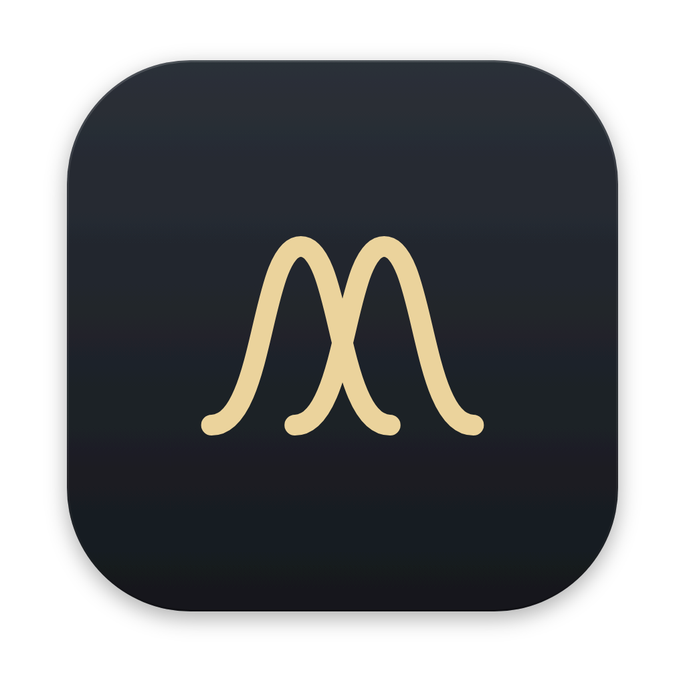
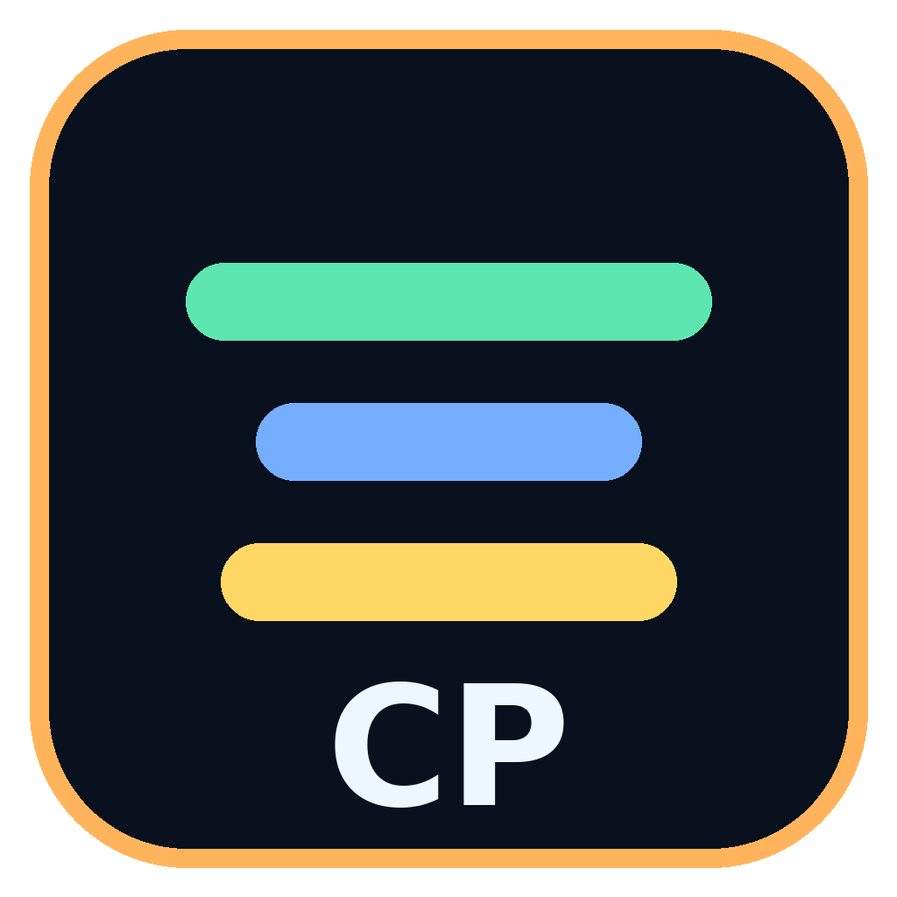
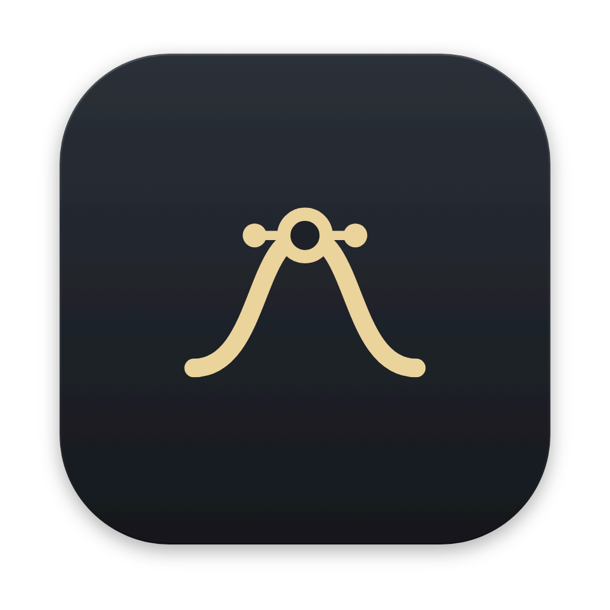
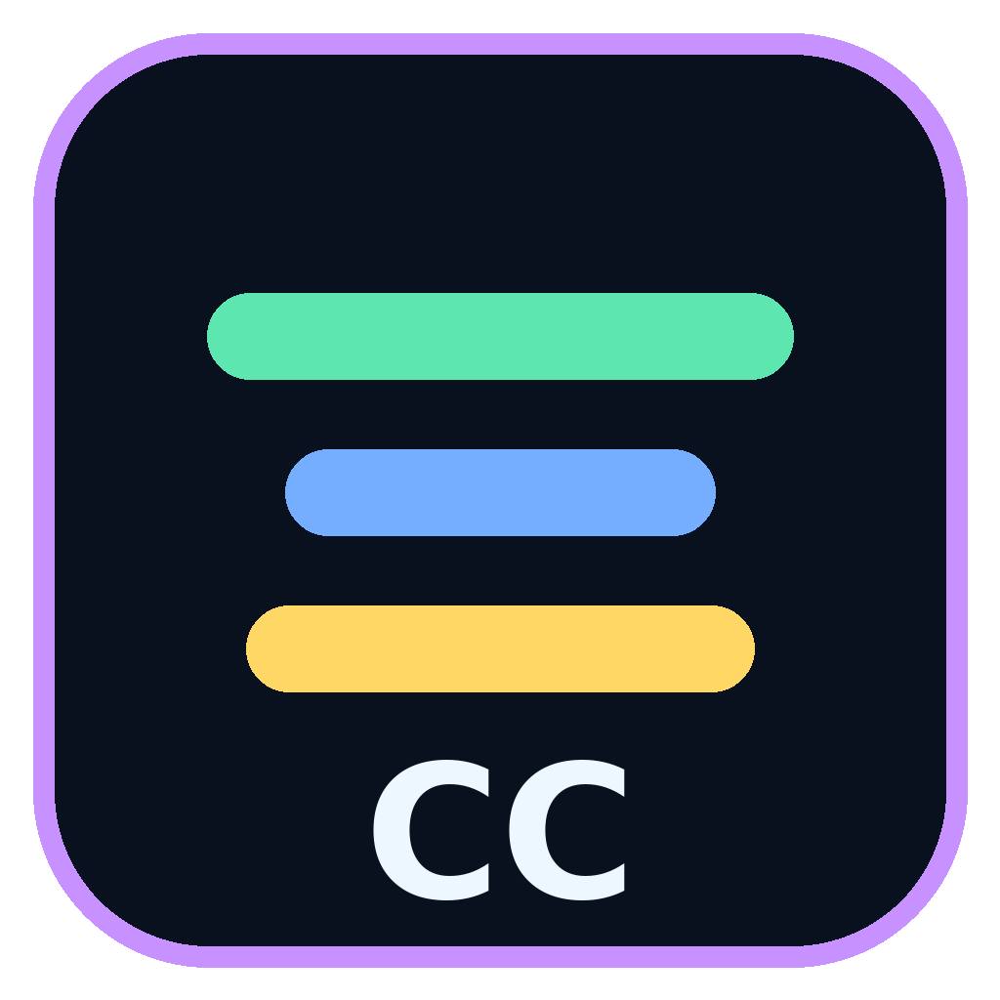
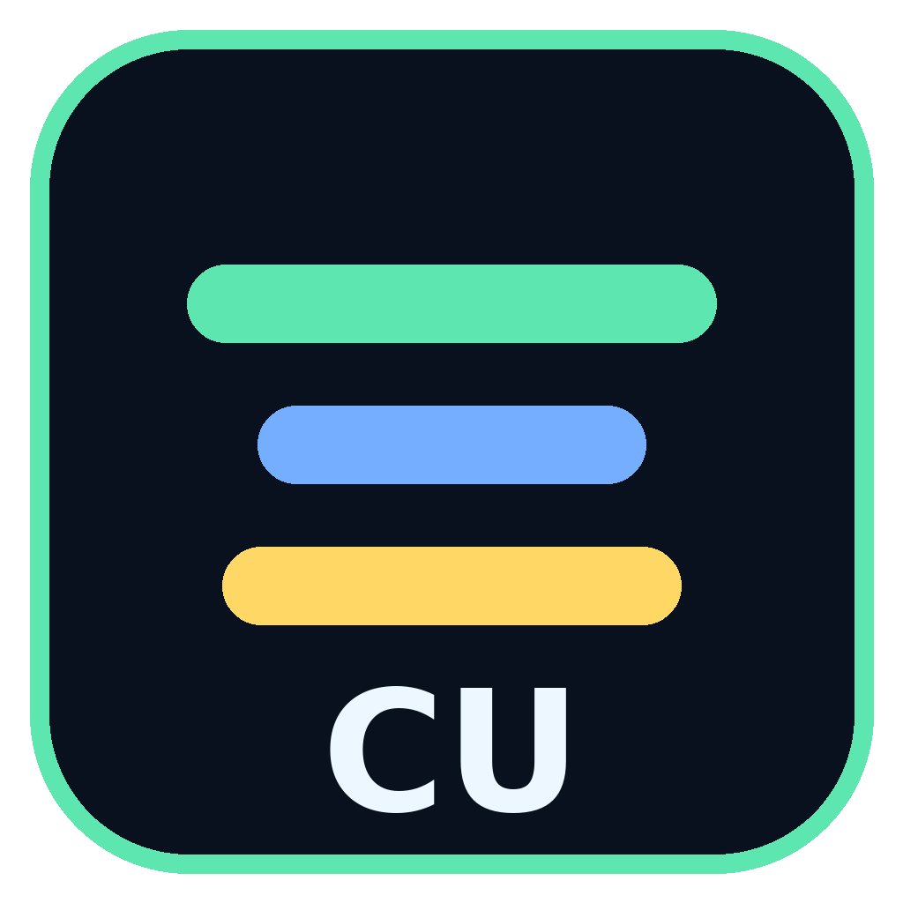
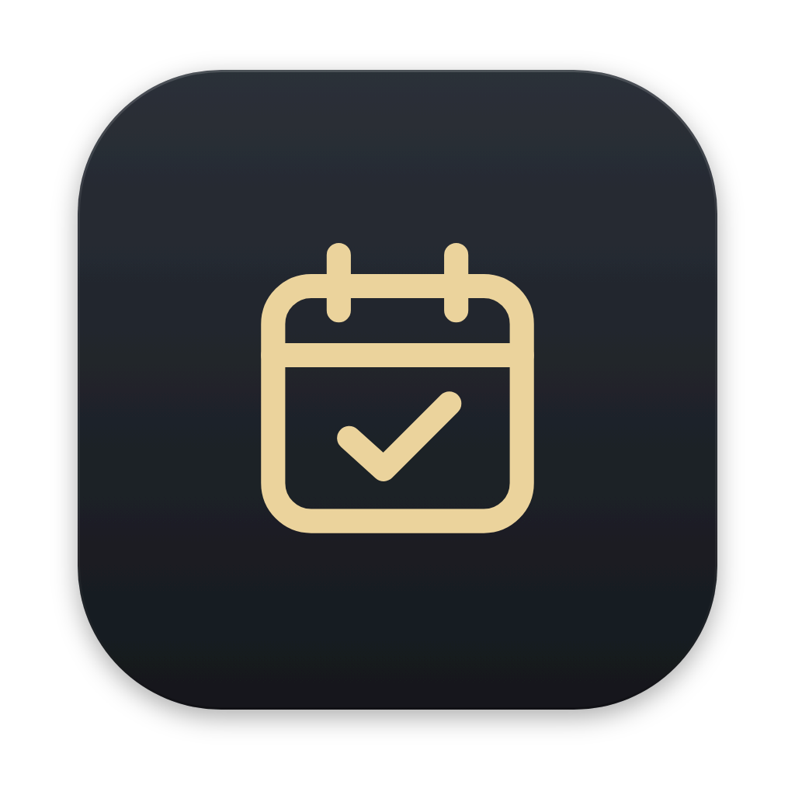
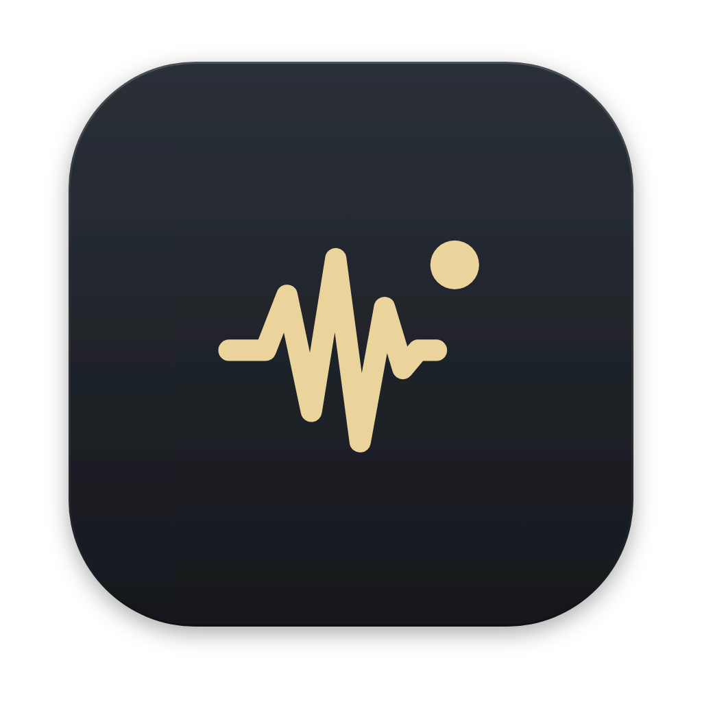
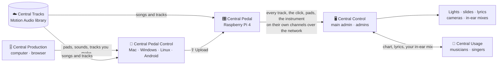

<div align="center">



# Central

**A pedal for your pads and tracks, and apps for the rest of the worship team.**

[](https://github.com/MotionAudio/Central-Apps/releases/latest)
[](https://github.com/MotionAudio/Central-Apps/actions)
[](LICENSE)

[**Download the apps**](https://motionaudio.github.io/Central-Apps/) · [All releases](https://github.com/MotionAudio/Central-Apps/releases/latest) · [Install guide](INSTALL.md) · [What's new](release-notes/HISTORY.md)

</div>

---

I make Central for worship teams. The Central Pedal sits at the worship leader's feet and plays the pads, the multitracks and the click. Central Control runs the lights, slides, lyrics and in-ear mixes from the desk. Every musician gets their own chart and their own mix in Central Usage. This repository has all of it: the pedal's software, the six apps, the website and the tools that build them.

If you just want to install something, go to the [download page](https://motionaudio.github.io/Central-Apps/). It works out which file your computer or phone needs. Every file is also on the [latest release](https://github.com/MotionAudio/Central-Apps/releases/latest).

Sam

## The apps

| | App | Who uses it | What it's for |
|:-:|---|---|---|
|  | **Central Pedal** | The worship leader, on stage | A Raspberry Pi 4 that starts straight into the pedal. It plays ambient pads and multitracks with the click, spoken cues, charts and lyrics, and it can be the guitar or keys rig. You play it with 12 footswitches, knobs, a touch screen, an expression pedal, MIDI or a Stream Deck. |
|  | **Central Pedal Control** | Whoever gets the songs ready | The pedal's app on your computer, tablet or phone. Build the setlist at home, set up the pads and the controls, then press **⇪ Upload** and it all goes to the pedal. |
|  | **Central Control** | The main admin and admins | The desk. Lights, slides, lyrics, cameras, in-ear mixes, the tracks and the mix, for the whole service. |
|  | **Central Usage** | Musicians and singers | Your chord chart, the lyrics, your instrument and your own in-ear mix. |
|  | **Central Services** | Everyone in the church | The schedule. Who's playing which Sunday, and whether they said yes. |
|  | **Central Production** | Anyone who makes sounds | A studio for recording tracks and making loops, pads, instruments, plugins and pedal boards. Use what you make in your own apps or sell it through Make & sell. It's free, and it runs on a computer or in the browser with the same projects. |

## Versions and updates

All six apps share one version number. The second number is a full release (10.3, 10.4) and the third is a fix (10.4.1).

Central Pedal, Central Pedal Control and Central Production get updates for good. A Central Control or Central Usage key gets the next ten releases from when it was bought, so a key bought at 9.4 is covered through 10.4. Renewing costs $20 and covers ten more. Nobody has to renew; the apps keep working on the version they have. Central Services is a monthly plan and is always current.

Each app checks for a new version when it opens and once a day, and installs it by itself unless something is playing, in which case it asks first. Updates never touch songs, setlists, settings, keys or sign-ins. Every download is checked against the release's `SHA256SUMS` before anything is replaced.

## What runs where

| | Central Pedal | Central Pedal Control | Central Control | Central Usage | Central Services | Central Production |
|---|:-:|:-:|:-:|:-:|:-:|:-:|
| **Raspberry Pi 4** | ✅ | | | | | |
| **macOS** (Apple Silicon and Intel) | | ✅ | ✅ | ✅ | ✅ | ✅ |
| **Windows** 10 and 11 | | ✅ | ✅ | ✅ | ✅ | ✅ |
| **Linux** (.deb and AppImage) | | ✅ | ✅ | ✅ | ✅ | ✅ |
| **Android** | | ✅ | | ✅ | ✅ | |
| **iPhone and iPad** | | ¹ | | ¹ | ¹ | ² |

¹ The App Store versions are waiting on the Apple developer account ([IOS-APP-STORE.md](IOS-APP-STORE.md)). Until then, Central Usage runs in Safari from the main admin's computer, and Central Pedal Control runs in Safari from the pedal (`http://padpedal.local:8080/control/`, then Add to Home Screen).
² In the browser, on the website's Central Production page.

GitHub Actions builds and tests every release on every system before it's published.

## How it fits together



## What it does

**Songs and tracks.** You can add a song from your own stems, from one WAV of the whole song (the stem splitter separates it on your computer into vocals, drums, bass, guitars, keys and the rest), from a MultiTracks.com or Loop Community download with its Ableton sections, or from Central Tracks. Planning Center plans come in with their songs, keys and arrangements. The pedal finds the tempo, key, beat grid and sections for you, and makes a click and a spoken guide from them. Key and tempo change on the fly without the stems drifting apart.

**On stage.** The Live screen shows the whole service. Safe Stop fades everything out over a couple of seconds if something goes wrong, the service lock stops anyone changing set-up mid-song, and a Ready check before the service catches a missing track or a click that would leak into the house. A second pedal can follow along silently as a backup and take over mid-song.

**The rig.** Guitar and bass pedalboards, with hundreds of free plugins on the Pi and a built-in rig on Windows and macOS. Keys from SoundFonts or your own plugins, with up to eight layers and splits. A tuner, an IR loader and a looper. On a computer you can use your own VST3, CLAP, Audio Unit and LV2 plugins, Kontakt and Keyscape included.

**The team.** Central Control pairs every device and gives each pedal its job. It runs DMX lights with 2,272 fixture profiles, slides and lyrics, NDI cameras, up to 64 in-ear mixes and talkback. Central Usage gives each musician their chart and mix, and practice mixes they can play at home.

**Making sounds.** Central Production records and mixes tracks with your own plugins, makes pads and instruments from samples, and has a plugin builder where you wire up your own effects. Everything you make can go straight into the other apps.

## Getting started

1. **Install the apps.** The [download page](https://motionaudio.github.io/Central-Apps/) picks the right file. [INSTALL.md](INSTALL.md) has the step-by-step for each system.
2. **Set up the pedal.** It arrives with its card in. Plug it in and set it up from your phone (below).
3. **Get your songs ready** in Central Pedal Control, then press **⇪ Upload** and type the pedal's name and code.
4. **Bring in the team.** The main admin installs Central Control, and the pedals and the musicians' devices pair with it.

### Setting up a Central Pedal

1. Plug in the power and your outputs. A screen on HDMI 1 is optional.
2. On your phone, join the Wi-Fi called **Central Pedal Setup**. The setup page opens by itself. If it doesn't, go to http://10.42.0.1.
3. Pick the church Wi-Fi and type its password.
4. Type a 4-digit code. If you use Central Control, use the main admin's code, which pairs the pedal with it. Otherwise any four digits will do. Central Pedal Control uses the same code.
5. Press **Upload**. The pedal joins the Wi-Fi and it's ready. If the password was wrong, Central Pedal Setup comes back after about a minute and the page tells you what happened.

When you move to a new building, **Settings → Network & devices → Turn the setup Wi-Fi on** runs it again.

### Building a card by hand

This is for people who build pedals. On an Ubuntu or Debian PC, from the folder you unzipped the newest `central-control-source.zip` into:

```bash
sudo WIFI_SSID="Church WiFi" WIFI_PASS="password" bash build-image.sh
```

The first build takes 40 to 60 minutes and needs the internet and about 15 GB free. You get `central-pedal-<version>.img`. Delete older images so nobody flashes one by mistake, and use a 16 GB card or bigger.

A few options you can set in front of the command:

- `PI_PASS=...` and `PI_HOSTNAME=...`
- `TFT=none` if there's no small screen, or another screen's id from `screens.json` (for example `TFT=waveshare35b`). The common blue 3.5" touch screen is on by default, and HDMI 1 still shows the full app.
- Leave out `WIFI_SSID` and the pedal makes its own **Central Pedal Setup** Wi-Fi for a phone.
- `FACTORY=0` skips the factory test.
- `I2S_DAC=off`, `SAFE_MODE=off`, `WIFI_COUNTRY=US`, `COMPRESS=1`
- `SOUNDS=small` leaves out the 1.2 GB grand piano, and `SOUNDS=none` leaves out the keys sound banks.

Flash it with Raspberry Pi Imager (*Choose OS → Use custom*, pick the `.img`, and answer **No** to *OS customisation*). The first start takes about a minute longer and restarts once. Wire the controls with `wiring.html`. Every part is optional, and the Learn tab can move any button or knob to any pin. A guitar needs a USB audio interface and a keyboard needs a USB MIDI port.

**The factory test.** A card from `build-image.sh` starts in a factory test. Plug a screen into HDMI 1 with a keyboard and mouse. It walks through every footswitch (its LED blinks), knob, slider, the expression pedal, the touch screen (a test pattern, its corners, calibration), the outputs, the instrument input, MIDI, Wi-Fi, temperature, power, storage and the sound banks. You can switch to a different touch screen there too. **Save report** keeps `factory-report.json` on the pedal. Press **Finish** and unplug it. The next start is the customer's: the test's Wi-Fi is forgotten, the touch screen setting stays, and it asks for the church Wi-Fi on their phone.

To add a Wi-Fi network later, put `pad-pedal-wifi.txt` on the card's `bootfs` partition (the network name on the first line, the password on the second), or use Settings on the pedal. To log in for maintenance: `ssh pi@padpedal.local`.

## Central Tracks

Central Tracks is the Motion Audio library, built into **Add a song → Central Tracks** on the pedal and in Central Pedal Control. You can search by song, artist or key. With Central Tracks Unlimited you can add anything; otherwise you buy the tracks you need, priced by each track's sound-quality grade. Teams publish their tracks on the Motion Audio website, and there are 20 hymns we arranged ourselves. Songs you import yourself never leave your devices. The server API is in [docs/CENTRAL-TRACKS-API.md](docs/CENTRAL-TRACKS-API.md).

## Documentation

| | |
|---|---|
| [INSTALL.md](INSTALL.md) | Installing and updating every app on every system |
| [IOS-APP-STORE.md](IOS-APP-STORE.md) | iPhone and iPad builds through TestFlight and the App Store |
| [DRIVE-SETUP.md](DRIVE-SETUP.md) | Keeping a copy of every release in Google Drive |
| [docs/SIGNING.md](docs/SIGNING.md) | Signing the Windows and Mac installers |
| [docs/DOMAIN-AND-EMAIL.md](docs/DOMAIN-AND-EMAIL.md) | Moving the website and email to motionaudio.org |
| [docs/PLANNING-CENTER-AND-CCLI.md](docs/PLANNING-CENTER-AND-CCLI.md) | Planning Center and CCLI |
| [docs/SHORTS.md](docs/SHORTS.md) | Automatic shorts and posting to social media |
| [docs/VIDEO.md](docs/VIDEO.md), [docs/VIDEO-INTEGRATION.md](docs/VIDEO-INTEGRATION.md) | Cameras, streaming and the video computer |
| [docs/PLUGIN-BUILDER.md](docs/PLUGIN-BUILDER.md) | Building plugins in Central Production |
| [docs/COMMUNITY-PLUGINS.md](docs/COMMUNITY-PLUGINS.md) | How community sounds, pedals and plugins are checked and paid for |
| [docs/CENTRAL-TRACKS-API.md](docs/CENTRAL-TRACKS-API.md) | The Central Tracks server API |
| [docs/DESIGN-SYSTEM.md](docs/DESIGN-SYSTEM.md), [docs/VOICE.md](docs/VOICE.md) | How the apps look, and how the words are written |
| [central-usage/README.md](central-usage/README.md) | Central Control and Central Usage in depth |
| [docs/brand/](docs/brand/) | The Motion Audio mark and the six app icons |
| [release-notes/](release-notes/) | The notes for every release |
| [The pedal's user guide](#the-pedals-user-guide) | Every tab of the Central Pedal, the hardware, the screens, MIDI and safe mode |

## What's new

**New in version 10.6.0:** Central Production can take a song all the way to the Central Pedal. Drag sections around and their music goes with them, move the whole song to a new key and tempo, add a click and spoken cues, check how loud it is and what Central Tracks will grade it, and export a pack the pedal reads with its sections marked. A MIDI footswitch or pad can run it too.

**New in version 10.4.2:** The website, the help guides, the manuals and the help inside the apps are rewritten in plain words, and the GitHub download page is up to date with all six apps.

**New in version 10.4.1:** On the pedal, Test sound now listens along the way and tells you where the sound stops, and fixes what it can. A pedal with only the headphone jack plays it directly. The pedal's screen is quicker.

**New in version 10.4.0:** In Central Production, a plugin knob is heard in about a fifth of a second, a MIDI keyboard plays through the track's plugins, exports keep plugin automation, and it uses noticeably less of the computer. Any delay in any app can follow the song's tempo.

**New in version 10.3.0:** Plugins play live on Central Production tracks without freezing. Shorts learn from what your church approves and post on a schedule. About twice as many pads, plugins, pedals, hymns, backgrounds and slide themes. A new website with pages for every app and sound pack, checkout, My products, Help and a status page.

**New in version 10.2.0:** Central Production arrived, along with the plugin builder, run sheets, the pre-service check, the band's screen, the slide designer, automatic shorts, Planning Center and CCLI, real light profiles and the Central Utility pack.

Older versions are in [release-notes/HISTORY.md](release-notes/HISTORY.md), and every release has its own notes in [release-notes/](release-notes/).

---

# The pedal's user guide

## The tabs

The tabs along the top are **Live, Pad, Tracks, Instrument, Looper, Controls, Learn** and **I/O**. Settings opens from the ⚙ button. On a keyboard, F8 is Live, F1 Pad, F2 Tracks, F3 Instrument, F9 Looper, F4 Controls, F5 Learn, F7 I/O and F6 Settings. You can also put *Show tab* on a footswitch.

### Live

This is the screen for the service. The setlist runs down the left, with a dot next to songs that have their tracks. Tap a song to load it; if something is playing, tap it twice.

The middle shows the song: its place in the setlist, key, BPM, time left and what's next. The sections are laid out in order, sized by length and coloured by type, and the one playing fills up as it goes. Tap a section to jump there on the next bar.

Under that are the transport buttons: previous section, play and pause, next section, **Vamp** (repeats this section until you press it again), **Safe Stop** and **Next song**. Safe Stop fades the tracks and pads out over 2.5 seconds; press it again to stop straight away. The pads, the instrument (with its tuner) and the meters are on the same screen.

Along the top you'll see the Pi's temperature, a low-power warning, the outputs, whether it's paired with the main admin, and two buttons:

- **Ready check** looks at everything before the service starts. It checks the sound is running and the outputs make sense (on a 4-output interface the click needs an output of its own; on a 2-output device a click in the main mix gets flagged, because the congregation would hear it). It checks every song in the setlist has its tracks and sections, and it looks at the Pi's temperature, power supply, storage, memory and pairing. Where it can fix a problem, there's a button next to it. *Ready check* is also an action you can put on a button.
- **Lock for service** locks the other tabs, the mixer, seeking and set-up actions, so a stray press can't change anything. Playing, sections, pads, the instrument and the tuner still work. Unlock it with the pedal's code. The small screen shows LOCKED while it's on.

**Report.** The pedal keeps a log of the service: songs loaded and played, how each one ended, sections, jumps, Vamp, Safe Stop, the lock, audio dropouts, and the temperature and power every minute while it plays. It's kept in `/data/pad-pedal/service-log/`, one file a day for 120 days. The day's report shows what was played, for how long, anything stopped early and the hottest the Pi got. **⬇ Download** saves it as text.

### Pad

Eight pads per song. Tap one to crossfade to it and tap it again to fade it out. There's a stop button, key up and down, two texture channels, tap tempo, layer, morph and freeze.

Built-in pads play in any key with no samples. Imported pads (MP3, WAV, FLAC, OGG, M4A or AIFF) have their key detected and get shifted to the song's key. If it guessed the key wrong, set the root key yourself.

The two texture channels have over 100 presets, like rain, vinyl, choir air, tape hiss and shimmer beds, each with its own level.

Every pad has its own effects: a 6-band EQ, a compressor with six characters, drive, an auto-filter, phaser, chorus, tremolo, stereo width, a delay that can follow the tempo, reverb with shimmer, and an LFO. The graphs are drawn from the real audio.

With **Layer** on, up to four pads play at once, each with its own level in the Layers box (or on a knob, *Pad layer N level*). A fifth pad fades out the oldest one. There are also octave layers, auto-swell, an audio input from a USB interface with its own effects, and output meters that warn HOT and CLIP.

### Scenes

A scene is a snapshot you save with a song. It can hold the pads (which ones and their levels), the track mix (faders, mutes and pans) and the instrument (which pedals are on, each pedal's Mix and Level, and the keys layers). Tick *+ board* to save the whole pedalboard or keys setup with it. Capture one from the song editor under **Scenes**.

A scene can change smoothly over the seconds you set, swell in slowly, or cut, and it can land straight away, on the next beat or on the next bar. You can have a scene load with the song or start with a section. You can also tap it, put it on a footswitch (*Scene: next*, *Scene: previous*, *Scene: recall scene N*), or call it from MIDI: press *MIDI learn* on the scene and send the note, CC or program change you want to use from a controller, Ableton or a console.

### Tracks

The multitrack player is built in, so there's nothing else to install.

**Adding songs.** **+ Song** opens *Add songs*. There are three places songs come from:

- **Planning Center.** Connect once with a Personal Access Token (from api.planningcenteronline.com → Personal access tokens). Pick a service type and an upcoming plan, and every song in it comes in with its key, tempo, time signature, the arrangement's order, its chord chart, lyrics and any audio attached to the arrangement. Audio in another key gets pitched to the service key. You can put the songs at the top of the setlist in service order.
- **A track pack.** A MultiTracks.com or Loop Community (Prime) download on a USB stick, zipped or unzipped. Stems are recognised by their names, the full mix is left out, and the title, key and tempo come from the file names. You can change any stem's role before importing. Sections come from the Ableton Live set or the MIDI file in the download. **Combine stems of the same kind** mixes, say, three drum stems into one Drums track, which saves faders and memory; the click and guide always stay separate. **Several songs…** imports a whole folder of downloads at once. If a pack is too big for the Pi's memory, it warns you first.
- **Your own files.** One file or a folder of stems, from a USB stick, from a phone (the Upload page) or from a computer on the network.

Every imported file is copied into `/data/pad-pedal/library/`, so the song still plays after the USB stick is gone, and it's included in every backup.

**What the pedal works out.** Tempo and key are detected (if it gets one wrong, the next guesses are one tap away), along with the beat grid, downbeats, sections and big hits. A click track is made from the beat grid, or the song's own click stem is used if it has one.

**Key and tempo.** Pitch and tempo change separately and on the fly, and the stems stay locked together. A song can change tempo and time signature part way through: in the song editor, under *Tempo grid → Tempo & time signature changes*, set the bar, the new BPM and beats per bar, with an optional slow-down over a few bars. The click, count-in, sections, MIDI clock and light hits all follow it.

**Flow.** Put the sections in the order you want to play them (Intro, V1, C, C, Bridge, C) and playback jumps between them without a gap on the bar line. While it plays, hold a section button (or a footswitch set to *Flow: play section N next*) to go there next, use *again* to repeat the current one or *skip* to drop the next, or turn flow off to play the song as recorded.

**The mixer.** Open it with 🎚 *Mixer* or the *Show the mixer* action. Each file you added gets a channel with a fader, a meter, mute, solo, pan and, with a big USB interface, its own output. The Tracks, Click and Cues masters are there too. The small strips on the Tracks tab are the same faders. Changes glide instead of clicking, and you can save mixes as scenes.

**When a song ends** (set in the song editor), the pedal can stop, load the next song and wait, play the next song after a gap, or segue: the next song loads on a second player and starts the moment this one ends, or crossfades over the seconds you set, with the pads carrying on. *Setlist: go into the next song now* does it from a footswitch.

**Stems** each have a volume and a pan. With a USB interface that has more than four outputs, each stem also gets an **Out** picker, so you can send the drums and bass to their own console channels. The picker only shows up when such an interface is plugged in.

**Per song** you can set the key, tempo, count-in, loops, sections (with markers you can drag), cue words and the pad set. The transport (play, pause, stop, start over, restart or repeat the section, previous and next section, key, previous and next song) works from the footswitches, the screen, the 3.5" screen or a phone.

With **Using tracks** on, the pads follow the song's key and each section's pad set as the track plays. A section marker can also switch the pad, swell it in or out, or stop it.

**Click and cues.** The click and the spoken cues ("Chorus", "Bridge", "1 2 3 4") go to output 3, so the band hears them and the house doesn't. To use your own voice, choose *Record cue words in your voice…* in the song editor, record a word with any microphone, and use it on any section like the built-in ones.

**Charts, sheet music and lyrics.** Upload a PDF or text chart (ChordPro, chords over lyrics, or `| G | C |` bars), or press **Listen & write chord chart** and the pedal writes one by listening to the stems, lined up with the sections. The current chord shows on the transport while the song plays. *Sheet music…* listens to one stem and writes what it plays as notation, guitar or bass tab, a piano roll, Nashville numbers or a chord chart, which you can export as SVG. Lyrics are split by section for the projector and phones. Charts and lyrics are shared with phones, the projector and Central Control.

**MIDI out.** Channel 1 (or the one you pick) sends hits for the lights, and the drum hits of split songs as their own notes: kick 36, snare 38, hi-hat 42 and crash 49 by default, each of which you can change or turn off. Channel 2 sends general MIDI: a program change per song, notes per section, and clock. The same hits and clock go over the network to Central Control. Ableton Link and MIDI clock sync are in Settings.

### Instrument

Plug a guitar into a USB audio interface, or a keyboard into a USB port, and the pedal becomes the rig. Its sound goes out on output 4, out of the way of the pads and tracks.

**Guitar.** Pick the input (any class-compliant USB interface, left, right or stereo), set the gain and noise gate, and build a pedalboard on screen. There are hundreds of pedals, from boosts, drives and fuzzes to compressors, wahs, modulation, pitch, delays, reverbs, amps and cabinets, built from the free LV2 and LADSPA plugins in the image (Guitarix, Calf, Invada, TAP, CAPS, swh, x42, Dragonfly, ZamAudio, MDA and others) plus ones made here. Tap a pedal to switch it on or off, open it for its knobs, and drag to reorder. Any delay can follow the song's tempo. There are ready-made boards, and you can save your own.

**Piano and keys.** A USB MIDI keyboard plays SoundFont sounds through FluidSynth: grand, upright and old pianos, electric pianos, organs, pads, strings, synths, basses, harp, woodwinds, bells and a full General MIDI bank, then through the same pedal chain. Transpose, velocity curve and sustain are there. To add your own sounds, use *Sounds → Add sounds…* with an `.sf2` SoundFont or a folder of WAV samples named by note (`C4.wav`, `F#3.wav`, `60.wav`) from a USB stick, or send an `.sf2` from a phone or computer with the Upload page.

**Mix and Level** are on every pedal. Mix blends the dry sound with the pedal, which is handy for parallel compression or a delay at 30%. Level sets how loud the pedal comes back. Both change live.

**IR loader.** Load a cabinet or acoustic body impulse response (.wav) from a USB stick with *+ Add IR from USB…*.

**Keys layers.** Up to eight sounds at once, like piano with a pad and strings. Each has its own volume, pan, octave, key range (*Split at C4* in one tap) and velocity range, and each can be a footswitch toggle or a knob.

**Tuner** mutes the output while it's open. **Auto** listens to the input, sets the gain and gate, guesses acoustic or electric, and picks a board.

Any pedal, board, sound, the tuner, the expression pedal (wah or volume) and the output level can go on a footswitch, knob or MIDI control in the Controls tab. Latency is 128 samples at 48 kHz on the Pi, plus whatever the interface adds.

### Looper

Three loops, worked from one footswitch: record, then play, then overdub. You can undo and redo, reverse a loop, play it at half speed, and set its level and pan. Loops can start on the next bar line and stay in time with the song, or run free. It records the instrument after its pedals and plays back on the instrument output.

### Controls

Every physical control, with what it does in the Pad layout and what it does in the Tracks layout, plus a hold action for each button. Pick from the action list. The LEDs follow what you set: on, off, or blinking on the beat.

### Learn

**Add new button**, give it a name, press Learn, then press the pedal. It works for GPIO pins, USB foot controllers (any HID pedal or keyboard key) and MIDI (note, CC or program change). For the 6 knobs, 2 sliders and 12 buttons on the control board, *Learn* scans every usable input for the one you move. It starts from the layout in `wiring.html`, and *Reset* puts it back.

### I/O

Every input and output on one page.

**Audio to Central Control** can be off, over Ethernet (a cable to the network or straight to the computer, which is best), over Wi-Fi (a little more delay), or through an audio interface (the pedal's outputs cabled into the other computer's interface). Over the network, every track goes on its own channel for Central Control to mix, along with the click and cues, the pads, the track mix and the instrument. Each channel is 48 kHz, or 24 kHz with *Saver* on a busy Wi-Fi. The page shows who's listening and what's being sent.

The same tab has the routing of the four outputs and each track's own output, the audio inputs, MIDI ports and the notes for the lights, what HDMI 1 and 2 show, the control surface, and the devices on the network.

### Settings

Settings opens from ⚙ and is grouped down the side: **Sound, Screens & displays, Look, Controls, Network & devices, Packages & key, Planning Center & CCLI, Saved setups, Software updates & backup** and **About & power**.

- **Sound** has the audio engine (sample rate and latency), where each output goes, the output device, and **Test sound**. Test sound plays a tone on each output, follows it along the way, and tells you where it stops.
- **Look** has the colour presets (Midnight, Worship warm, Stage black, Forest, Royal, Daylight, High contrast), your own colours, and the interface size.
- **ProPresenter.** Type its IP and port (in ProPresenter 7, turn on Settings → Network → Enable network). Each section can show a slide, and choosing a song can bring up its presentation.
- **Software updates.** The pedal checks once a day. When a new version is out, *Update ready* appears with *Install*, which waits until nothing is playing. The download is checked against the release's `SHA256SUMS`, and your songs and settings stay as they are.
- **Backup, restore and update from a USB stick.** *Back up to USB stick* writes `Central Control/central-control-backup-<date>.zip` with your songs and their audio, charts, lyrics, pads, keys sounds, recorded cues, light shows, setlists, the pin map and your settings. *Restore from USB…* lists the backups on the stick and puts one back. *Update software from USB…* installs a newer version from a `central-control-source.zip` on the stick, even with safe mode on, without touching your songs or settings.

## Setlists on every Central Pedal

Every Central Pedal, the Pi and the app on your computers, keeps the same song library and setlists. Open **Setlist → Setlists · Song library · Devices…**.

**Setlists** lists every setlist from every device, newest first. Open one, or make a new one. **Song library** has every song with its key, tempo, tracks and the setlists it's in. **+ Add** puts it in the open setlist. **Delete…** asks whether you mean this device or everywhere.

**Devices** shows the other Central Pedals on the network. Link to one once with its code (from its Settings), and after that they copy each other's songs and setlists every few seconds. The newest edit wins. A Raspberry Pi only keeps the tracks of songs that are in a setlist and leaves the rest on the computers until they're needed, and it warns you when the card is nearly full.

Devices find each other with a small broadcast on the network (UDP port 8094). If your network blocks that, use **Link by address…**.

## Parts for every instrument

Song editor → **Charts & sheet music → Parts for every instrument** (it's in Central Control's chart tab too). Pick the instrument: a chord chart, Nashville numbers, guitar (with capo, chord shapes and tab), bass, keys, vocals, trumpet, clarinet, alto and tenor sax, horn in F, trombone, violin, cello or drums. Each horn part is written in its own key.

**♫ Listen to every track** writes down what each track actually plays, so the bass part is the real bass line and the drum chart follows the real kick, snare and hi-hat. Click and guide tracks are skipped. When there's no track for an instrument, its part is written from the chords: the bass on the roots, keys voiced close, horns in the big sections, strings throughout, and a drum chart with fills that follows the sections.

**✎ Lyrics + chords from the vocal** listens to the vocal track and writes the lyric chart with each chord on the word it lands on. It runs on a computer, not the Pi.

## Audio outputs

| Output | What | Where it comes out by default |
|---|---|---|
| 1 | Tracks (every stem except the click and guide) | Headphone jack, left |
| 2 | Pads and textures | Headphone jack, right |
| 3 | Click and spoken cues | DAC board, left |
| 4 | Guitar or keys | DAC board, right |

A USB interface adds its outputs after those (5, 6 and on), or before them with *USB first* in Settings → Sound. You can move any of the four to any output, or switch to stereo pairs. The pedal builds one multi-channel output out of the jack, the DAC and the interface so they stay in sync. On a pedal with only the headphone jack, the jack is played directly.

On a plain stereo output (a computer, or the Pi without the DAC), the click can be mixed in, sent to the right channel, or sent to a second device.

## Hardware

12 buttons on GPIO, 6 knobs and 2 sliders on two ADS1115 boards (0x48 and 0x49), an optional expression pedal on a third (0x4A), the PCM5102A DAC on I2S (GPIO 18, 19 and 21), an optional 3.5" SPI screen and an optional rotary encoder. USB MIDI, USB foot pedals, USB sticks, a USB audio interface and a USB MIDI keyboard all work too. `wiring.html` has the whole thing. The pin map is kept in `/data/pad-pedal/hardware.json` (the Learn tab writes it), and `sudo systemctl restart pad-pedal-driver` reloads it by hand.

## Screens

**HDMI 1** shows the app by default. It can show a big copy of the small screen, lyrics or charts instead. **HDMI 2** shows lyrics for a projector by default, or charts, the stage display, the app, or nothing. Change them in Settings → Screens & displays.

The **stage display** (`/stage`, on either HDMI port or any tablet) shows the song, key, tempo, the section playing with a bar countdown, what's next, the lyrics and the beat, big enough to read across the stage.

The **3.5" touch screen** on the GPIO header has Pads, Tracks, Instrument and Settings tabs of its own. Pick the screen type and calibrate the touch in its Settings.

**Phones, tablets and computers** on the same Wi-Fi can open `http://padpedal.local:8080` (or scan the QR code in Settings) for the chord charts, lyrics, a remote and the Upload page. Anyone can look, but controlling anything needs the pedal's 4-digit code.

**Resolution and edges.** Each HDMI screen runs at its own native resolution unless you pick another. Zoom is automatic (100%, or 150% and 200% on 1440p and 4K monitors) or set by hand. *Edges cut off?* pulls the picture in on TVs that overscan. Changes apply within seconds while the music keeps playing. The Pi waits up to 20 seconds at start-up for a monitor to wake up, and lays the screens out again when one is plugged in or swapped later.

**Picture problems.** Use the micro-HDMI port next to the power socket for HDMI 1. Blurry text means the screen isn't at its native resolution, so set the resolution to *Automatic*. If the edges are missing, turn on the monitor's "Just scan" or "1:1" setting, or use *Edges cut off?*. The session's log is in `/tmp/pad-pedal-session.log`.

## MIDI in

Any note, CC or program change can be learned onto any input on the Learn tab. Out of the box, notes play the pads in that key (or the keys sounds when the Instrument tab is on piano and keys), CC 64 holds freeze or sustain, CC 7, 74, 91 and 73 are the Volume, Tone, Reverb and Fade knobs, CC 11 is expression, and MIDI clock sets the tempo. You can switch that off in Settings.

## Power-cut safe mode

Safe mode is on by default. The system partition is read-only and runs from memory, so pulling the plug can't damage it. Songs, stems, pads, charts, keys sounds, the pin map and the Wi-Fi settings are on the separate `/data` partition, which saves normally. Settings shows whether it's on and switches it (after a restart). Over SSH: `sudo pad-pedal-safe-mode on|off|status`. Updates from a USB stick work with it on.

## Keyboard shortcuts

`F1` to `F9` switch tabs (above), `1` to `8` play the pads, `Space` stops, `P` switches between Perform and Edit, `↑` and `↓` change key, `B` is tap tempo, `Z` freeze, `L` layer, and `[` `]` go to the previous and next song. `A W S E D F T G Y H U J` preview the pad in any key. On the Tracks tab, `Space` plays and pauses, `←` `→` move between sections, `R` repeats the section, `Home` starts over, and `+` `−` change key.

## Already have Raspberry Pi OS Lite on a card?

Copy this folder to the Pi, run `sudo bash install-kiosk.sh` and reboot. Add `TFT=none` if there's no small screen. Everything works except safe mode, which needs the separate `/data` partition the image makes. Run `bash get-sounds.sh sounds` first if you want the free keys sound banks.

## A shell on the Pi

Plug in a keyboard and press `Ctrl+Alt+F2`. `Ctrl+Alt+F1` goes back to the app. The logs are in `journalctl -u pad-pedal-driver -f` and `/tmp/pad-pedal-session.log`.

## Testing on a PC

You don't need a Pi to work on the pedal.

- `python3 pedal-driver.py --simulate /tmp/pp --app-root .`, then open `http://127.0.0.1:8766/app/` in Chrome. That's the whole app with a pretend control surface: type `press b1`, `knob k1 0.5` or `gpio 4 low` in the terminal. The phone pages are on `http://127.0.0.1:8080`. You'll need `pip install websockets gpiozero evdev pillow mido python-rtmidi`. With PipeWire on the PC the Instrument tab works too.
- `python3 test_pedal_driver.py` runs the driver against simulated GPIO, ADS1115 boards, USB pedals, MIDI, uploads, Planning Center, track packs, backups, updates and the sound checks.
- `bash test-session.sh` runs the HDMI session on a virtual screen with a real Chromium.
- `node test-integration.mjs` runs the real app in headless Chromium against the simulated driver (`npm i playwright && npx playwright install chromium`).
- `node test-headless.mjs` tests the app on its own.
- `python3 test_audio_routing.py` checks how the outputs are built.
- `python3 test_instrument_host.py` tests the native pedal and keys host against a real PipeWire graph (it needs `pipewire`, `wireplumber` and `fluidsynth`).
- `cd central-usage && node test-usage.mjs` covers Central Control; `node test-dmx.mjs` the DMX, Art-Net and sACN packets; `xvfb-run -a node test-app.mjs` the real Electron app.
- `node server/test/site-ui.mjs postgres://…` clicks through the website in a real browser.
- `node tools/brand/make-brand.mjs` redraws every app icon and website icon.
- `bash tools/bump-version.sh 10.4.1` sets the version on every app. Pushing to `main` with a version that has no release builds and publishes it.

## Files

| File | What it is |
|---|---|
| `index.html`, `css/`, `js/` | The pedal app: pads, tracks, instrument, controls, learn, settings, the engine, effects and graphics |
| `js/multitrack-worklet.js`, `js/analysis-worker.js` | The multitrack engine (key and tempo change, click, cues) and the tempo, key, section, chord and note analysis |
| `js/chords.js`, `js/notation.js` | Chord charts, transposing and the instrument views (shared with Central Control); sheet music, tab and piano roll |
| `js/pedals.js`, `js/plugin-ports.js`, `instrument-plugins.json` | The pedal catalogue and boards, and the plugin ports found in the image |
| `js/instrument.js`, `instrument_host.py` | The Instrument tab, and the PipeWire pedal chain and FluidSynth keys host behind it |
| `js/scenes.js`, `js/looper.js`, `js/integrations.js` | Scenes and pad layers, the looper, ProPresenter and update checks |
| `js/io.js`, `js/netsend.js`, `js/hub.js`, `js/colors.js` | The I/O tab, the audio sent to Central Control, the songs for Central Control, and the colours |
| `js/soundtest.js` | Settings → Sound → Test sound |
| `js/sources.js`, `js/central-tracks.js` | *Add a song*, Planning Center and Central Tracks |
| `js/license.js` | The license key and first-open setup (Central Control and Usage get a copy in `app/shared/`) |
| `js/stemsplit.js` | The stem splitter (the work happens in `StemSplitter` in `pedal-driver.py`) |
| `js/structure.js`, `js/practice.js` | Finding a song's sections; practice mixes and the phones' `/practice/` page |
| `js/backup.js`, `js/streamdeck.js` | The backup player; the Elgato Stream Deck |
| `js/transfer.js` | Upload and Download between Central Pedal Control and a pedal |
| `js/live.js`, `js/report.js`, `css/live.css` | The Live screen, the service lock, Safe Stop, the Ready check and the service report |
| `pedal-driver.py`, `hardware.json`, `pad-pedal-driver.service` | The pedal's driver (hardware, USB, MIDI, Link, the 3.5" screen, files, phone pages, Wi-Fi), its default pin map and its service |
| `sources.py` | The driver's side of *Add a song* |
| `companion/` | The pages phones, tablets and the projector open: charts, lyrics, remote, upload, stage, slides |
| `cues/` | The spoken cue words |
| `pad-pedal-session`, `xinitrc`, `bash_profile` | The kiosk session: audio, the HDMI screens, the cursor and the full-screen app |
| `starting.html`, `99-central-control-vc4.conf` | The start-up screen, and the X setting for the Pi's display driver |
| `pad-pedal-audio-config` | Builds the outputs in PipeWire (the jack, the DAC and a USB interface) |
| `pad-pedal-system`, `pad-pedal-safe-mode`, `pad-pedal.sudoers` | The root helper behind Settings (safe mode, screens, DAC, audio, Wi-Fi, hostname) |
| `build-image.sh`, `setup-pi.sh`, `install-kiosk.sh` | Building a card image, the OS setup both use, and turning an existing Pi OS Lite into a pedal |
| `get-sounds.sh` | Downloads the free keys sound banks |
| `firstboot.sh`, `pad-pedal-firstboot.service`, `pad-pedal-wifi-import.service` | The first start: the `/data` partition, safe mode and Wi-Fi import |
| `99-pad-pedal-usb.rules`, `99-pad-pedal-touch.conf` | USB sticks mount by themselves; the 3.5" touch panel is kept away from X |
| `wiring.html` (`make_wiring.py`, `wiring.template.html`) | The wiring guide and its generator |
| `native_rig.py` | The driver's bridge to the built-in rig on Windows and macOS |
| `central-usage/` | Central Control and Central Usage (Electron), with the audio engine, NDI sender and plugin host in `native/` |
| `central-usage-mobile/` | Central Usage for Android and iPhone/iPad (Capacitor) |
| `central-pedal-control/`, `central-pedal-control-mobile/` | Central Pedal Control for computers, and for phones and tablets |
| `central-services/` | Central Services |
| `central-production/` | Central Production for computers (the browser version is in `server/public/production/`) |
| `server/` | The Motion Audio website and its API: accounts, keys, the store, Central Tracks, Help |
| `docs/` | The download page on GitHub Pages, the brand files and the docs |
| `tools/` | Build helpers: the version bump, the website pages, the sound libraries, icons and CI checks |
| `release-notes/` | The notes for every release |
| `.github/workflows/` | `build.yml` builds and tests every system, `release.yml` publishes a release, `pages.yml` publishes the download page |
