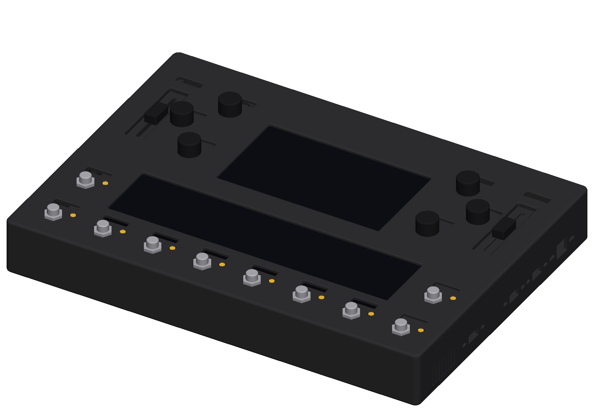
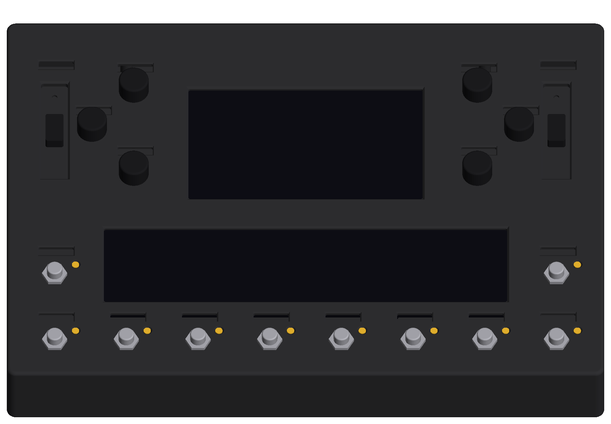
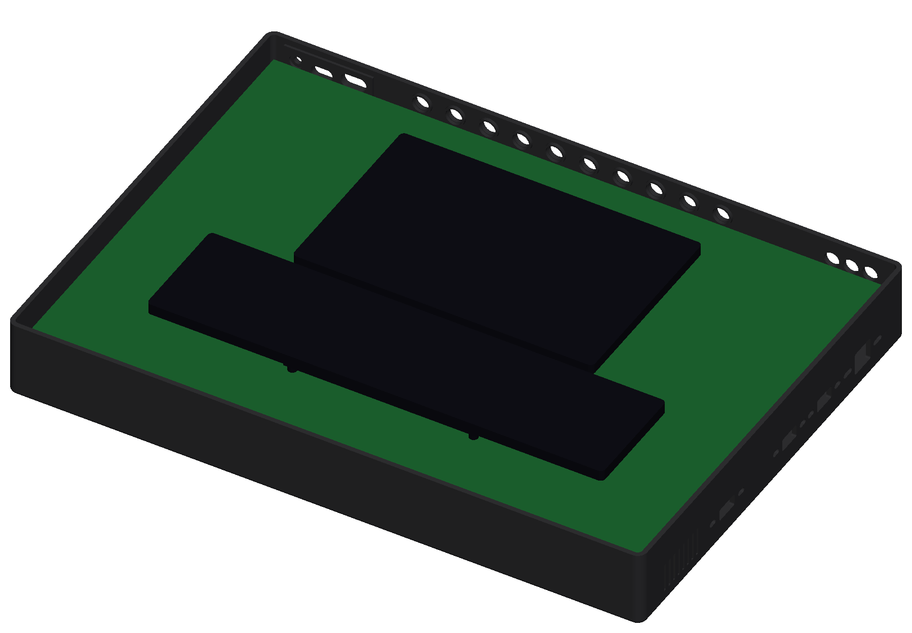
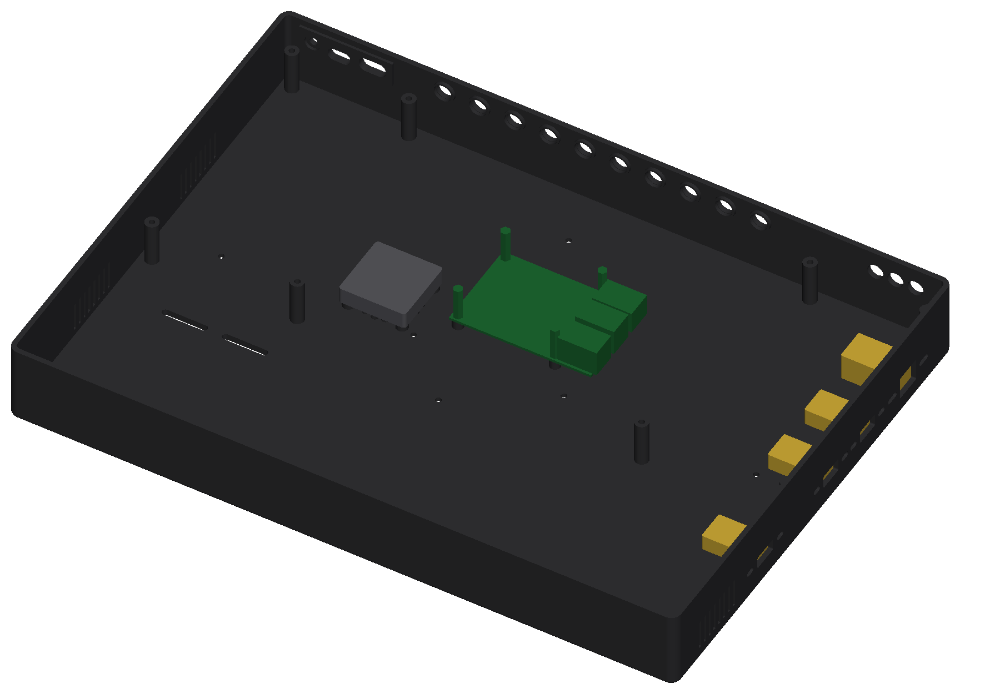

# Central Pedal rev B.3 - 3D-printed enclosure

A two-part plastic box: a **base** (tub with the back panel, the right-hand I/O panel, the Raspberry Pi mounts and
the fan mount) and a **top plate** that the footswitches, knobs, faders, label screens and the two touch screens come
through. Outside 400 × 288 × 52 mm (+ feet), rounded edges, black. Everything is generated by `enclosure.py`
(CadQuery) from the routed board's geometry, so every hole lines up with the board by construction.

**`central-pedal-blueprints.pdf`** is the drawing set: overview, assembly sequence, base, back and side panels, top
plate with the coordinates of every opening, board mechanical drawing and height stack, wiring and cables, parts to
buy and print settings. Start there.






## How it is built up

```
 knobs, footswitch nuts, fader caps
 top plate (printed)            <- 17 x M3 x 40 from under the base, into inserts in the plate
 7" display + 11.9" bar screen  <- screwed to the board from its back (on the bench)
 main board (PCBWay)            <- sits on the 17 base bosses + the 4 Pi standoffs, plugged onto the Pi header
 Raspberry Pi 4                 <- 4 x M2.5 x 20 male-female standoffs into M2.5 inserts in the base
 40 mm fan                      <- 4 x M3 x 16 into M3 inserts in the floor pads, blowing out through the floor
 base (printed)                 <- right wall: Ethernet, USB 3.0, USB 3.0, HDMI 2 on panel-mount leads
```

The Pi's USB, Ethernet and second HDMI come out on the **right side panel** through four short panel-mount extension
leads (the Pi sits in the middle of the box, so its own ports can't reach a wall). Its USB-C power port is not used:
the board powers the Pi through the GPIO header.

## Assembly order

1. **Base.** Heat-set inserts (soldering iron, ~230 °C): 4 × M2.5 in the Pi bosses, 4 × M3 in the fan pads. Fan onto
   the floor pads, label down so it blows out through the floor grille (4 × M3 × 16); the side vents are the intake.
   The four panel-mount leads into the right wall (M3 × 8 + nuts; the ear holes are slots, so any lead with ears
   26-38 mm apart fits). Power plunger into its back-panel hole from inside. 2S pack on its two hook-and-loop straps.
2. **Raspberry Pi.** Component side up, USB / Ethernet toward the right wall. 4 × M2.5 × 20 male-female hex
   standoffs: the male end goes down through each Pi hole into the base inserts, which screws the Pi to the case.
   Push the 2 × 20 extra-long stacking header onto the GPIO pins. Plug in the side-panel leads (Ethernet, the two
   blue USB 3.0 ports, HDMI1 next to the audio jack), the bar screen's HDMI lead (HDMI0 next to USB-C) and the
   USB-A to JST-PH-4 lead (a black USB 2.0 port); leave the other ends of the last two loose.
3. **Screens onto the board - on the bench.** Both screens are fixed by screws that go in from the **back** of the
   board into threaded posts on the screens, so they must go on before the board drops into the base (once it is in,
   nobody can reach its back). 7" Touch Display 2 glass up inside its silkscreen outline, 4 × M2.5 from the back into
   its four 8.5 mm posts; ribbon into the display and down through the slot beside J1. Its power lead to **J_DISP**
   (cut off the 3-way plug, crimp/splice a 2-pin JST PH 2.0: red pin 2, black pin 1). Bar screen glass up inside its
   outline, 4 × M2.5 from the back into its brass posts; its touch lead (the USB cable that came with it, USB-A end
   replaced by a 4-pin JST PH: 1 red 5 V, 2 white D−, 3 green D+, 4 black GND) from its TOUCH micro-USB to
   **J_USB_BAR**.
4. **Board onto the Pi.** Hold the board just above the base and connect the loose ends: 7" ribbon → Pi DISPLAY
   port, the HDMI lead → bar screen (its plug body drops into the board's HDMI PLUG slot), USB lead → **J_USB_UP**,
   fan → **J_FAN**, battery → **J_BAT**. Lower it: J1 slides over the stacking header and the board settles on the
   four Pi standoffs and the 17 base bosses. The board's four Pi holes take no screws - they sit under the 7" display
   - so the header and the 17 long screws in step 5 hold it.
5. **Top plate.** Black foam tape around the two screen windows on the plate's underside (1 mm for the 7", 2 mm for
   the bar, 5 mm wide). Set the plate on - shafts, levers, LEDs and footswitch bushings come through and the screens
   meet their gaskets. Turn it over and drive 17 × M3 × 40 from under the base: base boss → board → insert in the plate.
   Snug, not tight.
6. **Finish.** A washer and nut on each 1/4" jack outside the back panel (bagged with the board; the printed ring
   inside the wall takes the clamping force, not the solder joints). Footswitch nuts on top, the 6 knobs (6 mm D
   shaft), the 2 fader caps, 4 rubber feet in the corner recesses.

Before step 1, the printed tiles go together: heat-set M3 inserts in the plate (17 board bosses from the board side, 4
splice-bar bosses); base tiles glued on their half-laps and bolted with 7 × M3 × 12 + nuts (nut pockets underneath);
plate tiles glued on their laps with the two splice bars screwed across the front/back seam (4 × M3 × 8).

## What comes through the plate

| Control | How it comes through | What shows above the plate |
| --- | --- | --- |
| 10 footswitches | Ø 12.6 hole, M12 bushing, hex nut on top | the nut and the cap, like any pedal |
| 6 knobs | plain Ø 8 hole, no nut, 45° chamfer | 11 mm of D shaft - a 20 mm knob sits 1 mm above the plate |
| 2 faders | 18 × 78 mm recessed tray with a 3.6 × 64 lever slot | the cap, 6 mm proud of the tray floor |
| 10 LEDs | Ø 5.3 hole, chamfered | the 5 mm dome |
| 18 label screens | 23.4 × 6.6 window with a 1.2 mm 45° bezel | the OLED's 22.4 × 5.6 active area |
| 7" Touch Display 2 | 157 × 90 window with a 1.2 mm bezel; glass 1.1 mm below the plate's underside | the glass behind a 1 mm foam gasket |
| 11.9" bar screen | 270 × 60 window with a bezel; glass 2.4 mm below the plate's underside | the glass behind a 2 mm gasket |

The knobs and faders only work this way because the board uses **30 mm-shaft EC11 encoders** and the plate's
underside sits 16 mm above the board: the shaft top is 27 mm up, the plate top 19 mm. The fader lever (20.5 mm top)
could not clear a 19 mm top, so its cap runs in a tray whose floor is at 12.8-14.4 mm.

## Files

| File | What |
| --- | --- |
| `central-pedal-blueprints.pdf` | The 8-sheet drawing set (A3) |
| `central-pedal-enclosure.step` | The whole thing in position: base, plate, splice bars, power plunger, plus reference bodies (`ref-*`) for the board, the Pi, the screens, the fan, the side-panel leads, the cable plugs and the controls |
| `base.step`, `plate.step` | The two main parts whole (for a 400 × 290 mm printer bed, or CNC / laser work on the plate) |
| `base_*.step/.stl`, `plate_*.step/.stl` | The same parts cut into 2 × 2 tiles with half-lap seams; every tile fits a 220 × 220 bed |
| `splice-bars.*` | Two bars that stiffen the plate's front/back seam (one file holds both) |
| `power-plunger.*` | The pusher that sits in the back panel in front of the power button |
| `enclosure.py` | The parametric model. `python3 enclosure.py` rebuilds everything (`--no-tiles` skips the tile cuts); `check.py` runs the interference checks; `render_asm.py` makes the pictures; `blueprint.py` makes the PDF; `../geometry.py` writes `board-geometry.json` from the routed board |

## Hardware to buy

Enclosure: 4 × M2.5 heat-set inserts + 4 × M2.5 × 20 male-female hex standoffs (Pi), 25 × M3 heat-set inserts
(M3 × 5.7 × 4 mm OD: 17 plate bosses, 4 splice bars, 4 fan pads), 17 × M3 × 40 cap screws, 4 × M3 × 16 (fan),
4 × M3 × 8 (splice bars), 8 × M3 × 8 + nuts (panel leads), 7 × M3 × 12 + nuts (base laps), 6 knobs for 6 mm D shafts
(Ø 18-20, black with a gold line), 2 fader caps for a 4 mm lever, 4 × Ø 20 rubber feet, 2 × 25 mm hook-and-loop
straps, black foam tape 1 mm and 2 mm (5 mm wide).

Side panel leads (about $12-15 for all four): 1 × RJ45 panel-mount extension (20-30 cm), 2 × USB 3.0 A panel-mount
extension (30 cm), 1 × micro-HDMI male to HDMI-A female panel-mount extension (30-50 cm) - all the common kind with
two M3 ears.

Screens, Pi and cables (you fit these): Raspberry Pi 4, 2 × 20 extra-long stacking header, Raspberry Pi Touch
Display 2 (7"), Waveshare 11.9inch HDMI LCD (touch), 40 × 40 × 10 mm 5 V fan with a JST PH 2.0 plug, a slim
mini-HDMI to micro-HDMI lead (~30 cm), a short USB-A plug lead with a 4-pin JST PH end, one 2-pin and one 4-pin JST PH
2.0 pre-crimped pigtail, heat-shrink, 2S Li-ion pack with BMS and a JST VH 2-pin lead.

## Printing

- Material: PETG, ASA or ABS (it gets stepped on; PLA creeps under the footswitch nuts). Black, matte if you have
  it - the brand is black and gold.
- Plate tiles print upside down (flat top face on the bed). 0.2 mm layers, 5 perimeters, 40 % infill; the fader tray
  floors are 1.6 mm and the lap steps 1.5 mm - keep 100 % infill on the top/bottom layers.
- Base tiles print floor-down: 4 perimeters, 25 % infill. The back and side panel holes bridge without support; the
  vent slots are vertical. The half-lap steps and the Pi / fan bosses need no support.
- Splice bars, plunger: flat, 100 % infill.

## Numbers the model is built on - check these before printing

| Item | Value in the model | Where it comes from |
| --- | --- | --- |
| Plate underside above the board | 16.0 mm (top 19.0) | footswitch bodies 15.25 mm, 1/4" jack bodies 12.6 mm |
| 1/4" jacks | axis 6.3 mm above the board, Ø 9.9 hole, spacer ring 10.6/13 inside the wall | HOOYA PJ-611E drawing: 12.6 mm body, 3/8in-32 bushing 8.7 mm long, nut + washer outside the 3 mm wall |
| 3.5 mm jacks (MIDI in, MIDI out, phones) | 2.6 mm, Ø 9.5 hole | PJ-320D (the plug body has to reach a jack set behind the panel) |
| USB-C / USB-A windows | 13.5 × 8 / 16 × 9 mm | sized for plug overmoulds; 3 mm inner pad so plugs reach the sockets at the board edge |
| Pi | PCB 20 mm below the board on M2.5 × 20 standoffs, bosses 5.8 mm tall on the floor | Pi 4 hole pattern 58 × 49 |
| Right side panel | Ethernet, USB, USB, HDMI cut-outs centred 17.7 mm above the base's underside | common panel-mount leads: RJ45 17 × 14.5, USB 15.4 × 8.2, HDMI 16.2 × 7.6 face, M3 ears in slots |
| Fan | 40 × 40 × 10 on 4 mm floor pads, under the board at board (126, 112) | grille in the floor under it, intake vents in both side walls |
| 7" Touch Display 2 | 189.32 × 120.24, active 155 × 88, centre (195, 94); glass 14.92 above the board on 8.5 mm posts | Raspberry Pi product brief drawing |
| 11.9" bar screen | 287.3 × 69.8, active 268.18 × 57.98, centre (195, 193); glass 13.65 on 4 mm posts | Waveshare's drawing and STEP model |
| Label-screen windows | 23.4 × 6.6 mm, 1.2 mm bezel | 0.91" module's 22.4 × 5.6 mm active area; modules stand 12.5 mm above the board |

`check.py` confirms the printed parts clear the board, the Pi, both screens with their posts, the fan, the side
leads, the cable plugs, the label-screen modules, the encoder shafts, fader levers, footswitches, LEDs, jacks and the
tall capacitors. One thing to know: the 7" display's left edge passes 0.3-0.8 mm from the ends of the three knob
label-screen modules on that side (K1-K3) - check they sit straight in their sockets before the display goes on.

## Changing it

Everything is a parameter at the top of `enclosure.py`: seam positions (`PLATE_SEAM_X/Y`, `BASE_SEAM_X/Y`) for a
different printer bed, the side panel ports (`SIDE_IO`, `IO_SPEC`), the fan (`FAN_AT`), the Pi mounts (`PI_INSERT`),
screen sizes and heights (`DISP7`, `BAR`), jack heights, wall and floor thickness, plate height, hole sizes and
chamfers. The board geometry it reads (`out/board-geometry.json`) is written by `../geometry.py` from the routed
KiCad board, so if the board changes, re-run that and rebuild.
